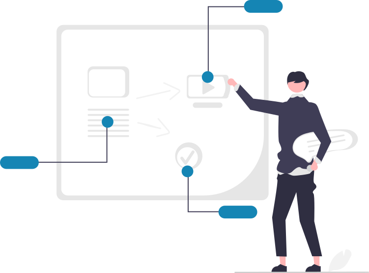
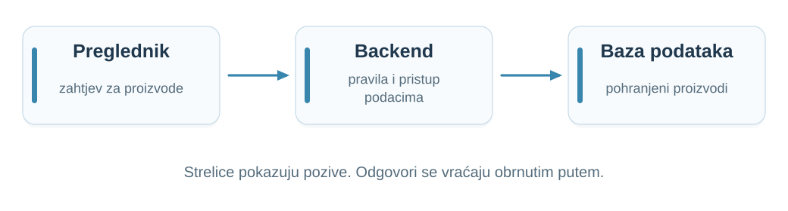
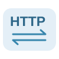
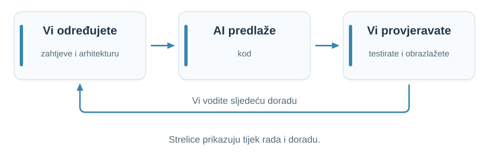
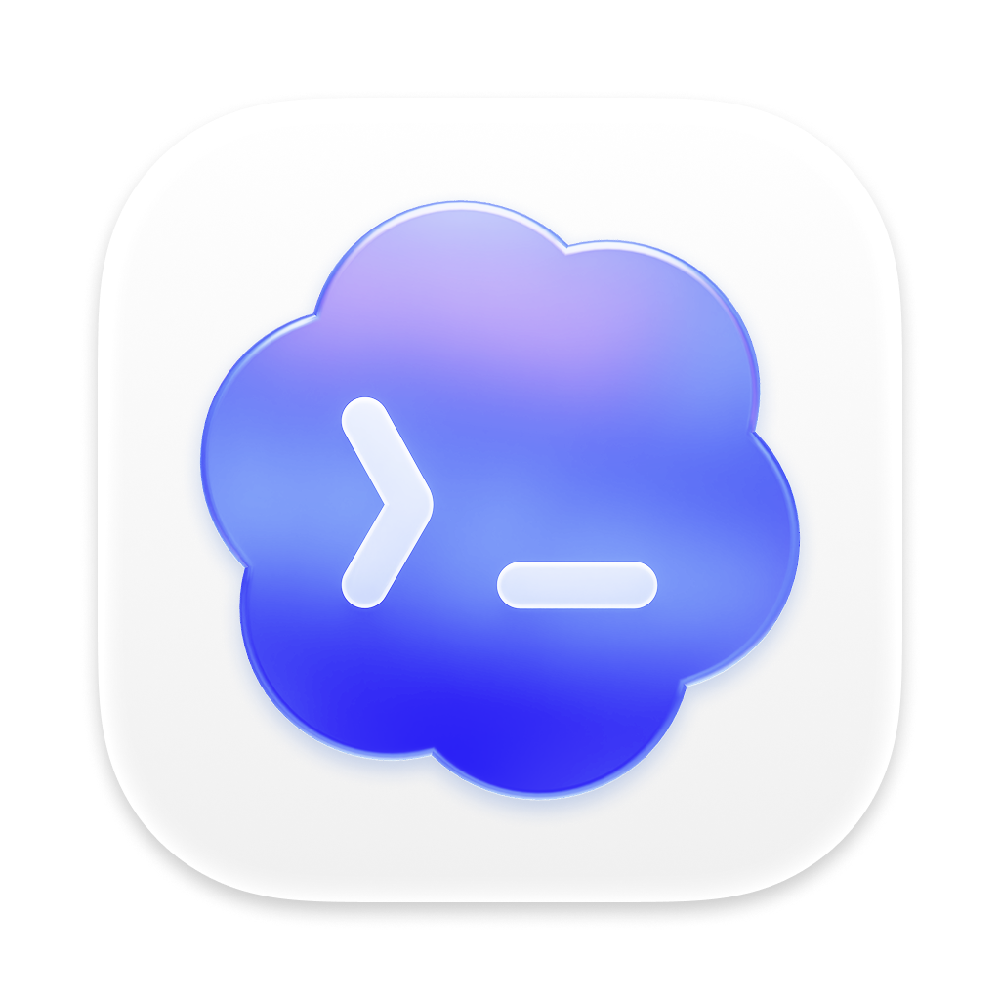
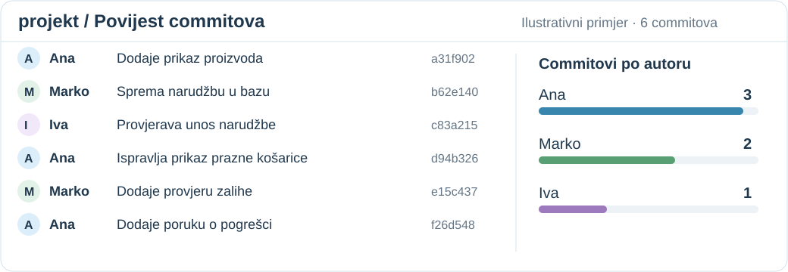
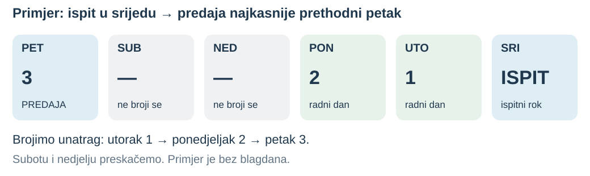
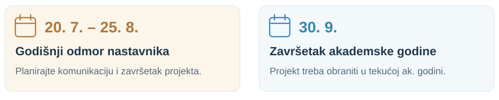
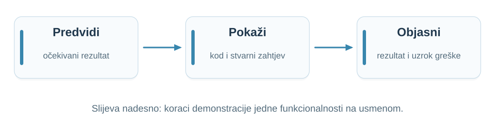
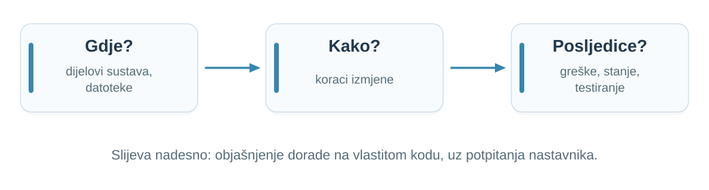

## Prisutnost i sudjelovanje {.stock-slide}

:::: {.columns}
::: {.column width="52%"}
**Dolazak nije obvezan.**

Ako dolazite, aktivno sudjelujte:

- Postavljajte pitanja.
- Predvidite rezultat.
- Objasnite svoje odluke.

Evidentirajte prisutnost QR kodom na sljedećem slajdu.
:::
::: {.column width="43%"}
{fig-alt="Nastavnik objašnjava ideje na ploči."}
:::
::::

::: {.notes}
Vrijeme: 0.5–1.5 min (1 min).
Dolazak na predavanja i vježbe nije obvezan. Potaknite aktivno sudjelovanje. Slijedi kratka evidencija; ne predstavlja bodovni prag.
:::

## Evidencija prisutnosti {#attendance .attendance-slide}

::: {.attendance-content}
[{width=455 height=455 fig-alt="QR kod za evidenciju prisutnosti na kolegiju Web aplikacije."}](https://bit.ly/wa-tu-sam)

[bit.ly/wa-tu-sam](https://bit.ly/wa-tu-sam)
:::

::: {.notes}
Vrijeme: 1.5–2 min (0.5 min).
Ostavite pola minute za evidenciju putem QR koda ili poveznice.
:::

## Što predavanje daje, a AI i materijali ne daju? {.value-slide}

AI dobro objašnjava pojmove, a materijali i, gdje postoje, snimke dostupni su i bez dolaska. **Ako samo slušate, oni vam mogu biti jednako dobri.** Uživo dobivate ovo:

::: {.value-grid}
::: {.card}
**Odgovor na vaše pitanje**

Zabunu ispravljamo dok nastaje, na vašem primjeru.
:::
::: {.card}
**Prioriteti**

Što je bitno za projekt, obranu i usmeni, a što je samo zanimljivo.
:::
::: {.card}
**Razmišljanje naglas**

Kako se rješava problem bez gotovog odgovora, s kompromisima i greškama.
:::
::: {.card}
**Rasprava s kolegama**

Isti problem, više obranjivih rješenja. Obrana traži upravo to.
:::
:::

::: {.notes}
Vrijeme: 2–3 min (1 min).

- Budite iskreni: AI, materijali na Moodleu i javnom webu kolegija te snimke, gdje postoje, dobro pokrivaju objašnjenje pojmova. Predavanje vrijedi kad je interaktivno.
- Pitajte: što ste zadnji put naučili od AI-ja, a što ste ipak morali nekoga pitati?
- Ne obećavajte snimku svakog predavanja dok to nije potvrđeno.
- Prijelaz: različiti studenti dolaze iz različitih razloga.
:::

## Različiti studenti, različiti razlozi {.value-slide}

| Ako ste… | Predavanje vam daje… |
|:---|:---|
| **samouki, s AI-jem i materijalima** | provjeru razumijete li zaista; dođite barem kad zapnete |
| **netko kome treba ritam** | strukturu tjedna i manje gradiva za kraj semestra |
| **tihi, ne volite pitati naglas** | slušanje bez pritiska; pitanja možete postaviti u Google Chatu FIPU WA |
| **zaposleni ili s obvezama** | materijale i, gdje postoje, snimke za samostalan rad |
| **usmjereni na ocjenu** | način razmišljanja koji se traži na obrani i usmenom ispitu |

**Dođite kad vam to nešto daje. Ako dođete, sudjelujte.**

::: {.notes}
Vrijeme: 3–3.5 min (0.5 min).

- Nitko nije kažnjen zbog nedolaska; dolazak nije obvezan.
- Tihim studentima ponudite Google Chat FIPU WA kao jednako vrijedan kanal za pitanja.
- Zaposlenim studentima ne predstavljajte snimke kao punu zamjenu dok nije potvrđeno koja su predavanja snimljena.
:::

## Nastavnici

| **Dio nastave** | **Nastavnik** |
|:---|:---|
| Predavanja | izv. prof. dr. sc. Nikola Tanković |
| Vježbe | Luka Blašković, mag. inf. |

**Google Chat: FIPU WA**

**Moodle (e-učenje):** [e-ucenje.unipu.hr](https://e-ucenje.unipu.hr)

**Javni web kolegija:** [ntankovic.unipu.hr/wa](https://ntankovic.unipu.hr/wa)

::: {.notes}
Vrijeme: 3.5–4 min (0.5 min).

Predstavite nastavnike i njihove uloge. Za komunikaciju o kolegiju uputite studente na Google Chat, grupu „FIPU WA”. Pokažite i Moodle (e-ucenje.unipu.hr) te javni web kolegija (ntankovic.unipu.hr/wa).
:::

## Čime se kolegij bavi {.visual-slide}

**Što se događa kada zahtjev stigne na backend?**

{width=1040 fig-alt="Preglednik poziva backend, a backend bazu podataka; odgovori se vraćaju obrnutim putem."}

Gdje su pravila i stanje? Što ako dva zahtjeva stignu istodobno ili neka komponenta ne odgovori?

::: {.notes}
Vrijeme: 4–5.5 min (1.5 min).

Povežite poznati frontend s backendom. Pitajte: ako dva kupca naruče posljednji artikl, tko mora zaštititi zalihu? Primjer naručivanja služi učenju i nije zadana tema studentskog projekta.
:::

## Plan nastave · 1.–3. tjedan {.course-plan-slide}

::: {.plan-entry data-week="01"}
**Kako web aplikacije rade**

Polazimo od poznatog frontenda i Firebasea. Pratimo kako preglednik traži podatke od poslužitelja i kako mu se vraća odgovor.
:::

::: {.plan-entry data-week="02"}
**Arhitektura backend aplikacije**

Razdvajamo kod koji prima zahtjev, provodi pravila aplikacije i pristupa podacima. Na primjeru narudžbe pokazujemo kako organizirati backend koji raste.
:::

::: {.plan-entry data-week="03"}
**REST i dizajn API-ja**

Dogovaramo kako frontend traži podatke i šalje promjene backendu. Oblikujemo adrese, poruke i odgovore na pogreške tako da ih klijent može jasno razumjeti.
:::

::: {.notes}
Vrijeme: 5.5–6.25 min (0.75 min).

Kratko povežite tri predavanja kroz razvoj iste aplikacije za naručivanje. Najavite što ćemo raditi; pojmove ćemo objasniti na pripadajućem predavanju. Svako tehničko predavanje traje 90–120 minuta, uključujući raspravu i ponavljanje.
:::

## Plan nastave · 4.–6. tjedan {.course-plan-slide}

::: {.plan-entry data-week="04"}
**Baze podataka i trajna pohrana**

Spremamo proizvode i narudžbe tako da ostanu sačuvani nakon gašenja aplikacije. Upoznajemo osnove PostgreSQL-a i MongoDB-a te uspoređujemo izbor baze za projekt.
:::

::: {.plan-entry data-week="05"}
**Transakcije i konkurentnost**

Istražujemo što se događa kada dva kupca istodobno naruče posljednji artikl. Povezujemo promjene podataka u cjelinu i sprječavamo pogrešne zalihe.
:::

::: {.plan-entry data-week="06"}
**Autentikacija i autorizacija**

Razlikujemo prijavu korisnika od provjere što taj korisnik smije raditi. Štitimo narudžbe tako da korisnik ne može čitati ili mijenjati tuđe podatke.
:::

::: {.notes}
Vrijeme: 6.25–7 min (0.75 min).

Kratko povežite tri predavanja kroz razvoj iste aplikacije za naručivanje. Najavite što ćemo raditi; pojmove ćemo objasniti na pripadajućem predavanju. Svako tehničko predavanje traje 90–120 minuta, uključujući raspravu i ponavljanje.
:::

## Plan nastave · 7.–9. tjedan {.course-plan-slide}

::: {.plan-entry data-week="07"}
**Sigurnost web aplikacija**

Provjeravamo što se događa kada netko namjerno pošalje neočekivane podatke. Učimo zaštititi unos, lozinke i tajne podatke te prepoznati česte propuste.
:::

::: {.plan-entry data-week="08"}
**Asinkrona obrada u backendu**

Izdvajamo sporije poslove, poput slanja e-pošte i izrade računa, iz obrade korisnikova zahtjeva. Pratimo kako se posao izvršava u pozadini i što ako ne uspije.
:::

::: {.plan-entry data-week="09"}
**Pouzdanost i obrada pogrešaka**

Razmatramo spor odgovor, nedostupnu uslugu i prekinutu vezu. Određujemo kada ponoviti pokušaj i kako spriječiti da ponavljanje dvaput izvrši istu narudžbu.
:::

::: {.notes}
Vrijeme: 7–7.75 min (0.75 min).

Kratko povežite tri predavanja kroz razvoj iste aplikacije za naručivanje. Najavite što ćemo raditi; pojmove ćemo objasniti na pripadajućem predavanju. Svako tehničko predavanje traje 90–120 minuta, uključujući raspravu i ponavljanje.
:::

## Plan nastave · 10.–12. tjedan {.course-plan-slide}

::: {.plan-entry data-week="10"}
**Performanse i skalabilnost**

Mjerimo gdje aplikacija troši vrijeme prije nego što je ubrzavamo. Istražujemo brži pristup podacima, privremeno čuvanje rezultata i rad više primjeraka backenda.
:::

::: {.plan-entry data-week="11"}
**Testiranje, praćenje i dijagnostika**

Testovima provjeravamo očekivano ponašanje i pogreške. Pomoću zapisa rada i mjerenja rekonstruiramo što se dogodilo kada zahtjev zakaže ili postane spor.
:::

::: {.plan-entry data-week="12"}
**Implementacija i rad u produkciji**

Povezujemo dijelove aplikacije u sustav dostupan korisnicima. Razmatramo postavke, sigurno povezivanje, pokretanje i gašenje te nadogradnje aplikacije.
:::

::: {.notes}
Vrijeme: 7.75–8.5 min (0.75 min).

Kratko povežite tri predavanja kroz razvoj iste aplikacije za naručivanje. Najavite što ćemo raditi; pojmove ćemo objasniti na pripadajućem predavanju. Svako tehničko predavanje traje 90–120 minuta, uključujući raspravu i ponavljanje.
:::

## Predznanje {.prerequisites-slide}

Oslanjamo se na programiranje, JSON i iskustvo s frontend aplikacijama.

:::: {.tech-grid}
::: {.tech-card}
{fig-alt="JavaScript"}

**JavaScript**
:::

::: {.tech-card}
{fig-alt="Vue"}

**Vue**
:::

::: {.tech-card}
{fig-alt="Pinia"}

**Pinia**
:::

::: {.tech-card}
{fig-alt="Firebase"}

**Firebase**
:::
::::

::: {.http-start}
{fig-alt="HTTP: razmjena poruka"}

**HTTP učimo od početka.** Kako preglednik komunicira s poslužiteljem?
:::

::: {.notes}
Vrijeme: 8.5–9.5 min (1 min).

Polazimo od frontenda i pozivanja Firebase biblioteke. Ne pretpostavljamo znanje o HTTP-u, TCP-u ni mrežnoj komunikaciji iza tog poziva. Pozovite studente da prepoznaju dijelove prethodnog znanja koje trebaju obnoviti. Kratka pojašnjenja dajemo kada su potrebna za backend problem.
:::

## Tehnologije u primjerima

| **Dio aplikacije** | **Tehnologija** |
|:---|:---|
| Frontend | Vue 3 i Pinia |
| API i backend | REST API i Node.js |
| Baza podataka | PostgreSQL ili MongoDB |

**Obradit ćemo osnove obiju baza. Za projekt birate jednu.**

Za korištenje tehnologija u projektu koje se razlikuju od onih s predavanja i vježbi potrebno je **prethodno izričito odobrenje nastavnika**.

::: {.notes}
Vrijeme: 9.5–10.5 min (1 min).

Razlikujte načela, tehnike i proizvode. Studenti za projekt mogu odabrati PostgreSQL ili MongoDB. Usporedite osnove relacijskog i dokumentnog modela te tražite obrazloženje izbora prema podacima i načinu pristupa. Za odstupanje od tehnologija s predavanja i vježbi studenti moraju unaprijed dobiti izričito odobrenje nastavnika. Prenosivost koncepata na druge jezike i frameworkove ne znači da ih smiju samostalno odabrati za projekt. Redis, redove poslova i Docker uvodimo samo kada pomažu objasniti konkretan mehanizam.
:::

## AI i provjera razumijevanja {.visual-slide}

**Vi provjeravate i objašnjavate rezultat.**

{width=1040 fig-alt="Student određuje zahtjeve i arhitekturu, AI predlaže kod, student provjerava, testira i obrazlaže odluke."}

Pokažite provjeru koda, slučaj u kojem pretpostavke ne vrijede i moguću jednostavniju izvedbu.

**Zapise razgovora s AI-jem ne predajete.** Dovoljni su commitovi i obrana.

::: {.notes}
Vrijeme: 10.5–11.5 min (1 min).

- Ovaj slajd otvara projektni dio: prvo pravila za AI, zatim alati, commitovi, pravila polaganja i obrana.
- Ponudite primjer: AI je sakrio gumb za tuđu narudžbu u sučelju. Je li time spriječen izravan zahtjev prema API-ju? Neka studenti predlože provjeru.
- Cilj je samostalno obrazloženje i dokaz ponašanja, a ne količina generiranog koda. Ako je student koristio AI, treba pokazati konkretnu provjeru njegova koda, prepoznati pretpostavke i objasniti moguću jednostavniju izvedbu.
- Zapisi razgovora s AI-jem ne traže se. Neobavezno: kratak odjeljak „Uporaba AI-ja” u README-u projekta (koji alati, za što, kako je rezultat provjeren).

Izvor: nastavnikov dokument „Pitanja za usmeni ispit – Web aplikacije”, odjeljak 11, „Provjera koda nastalog uz pomoć AI-ja”, str. 5.
:::

## Preporučeni AI alati {.ai-tools-slide}

:::: {.ai-tools-grid}
::: {.ai-tool}
{fig-alt="Claude"}

**[Claude Code](https://code.claude.com/docs/en/overview)**

Rad na kodu projekta, objašnjenja i provjere.
:::
::: {.ai-tool}
{fig-alt="Claude"}

**[Claude Design](https://claude.com/product/design)**

Ideje za sučelje i interaktivni prototipovi.
:::
::: {.ai-tool}
{fig-alt="Codex"}

**[Codex](https://learn.chatgpt.com/docs/code-review)**

Razumijevanje promjena i pregled koda.
:::
::::

::: {.open-models}
**Otvoreni modeli za istraživanje**

[Qwen3-Coder](https://github.com/QwenLM/Qwen3-Coder) · [DeepSeek-Coder-V2](https://github.com/deepseek-ai/DeepSeek-Coder-V2)

Modeli s dostupnim težinama za preuzimanje; za pokretanje trebaju odgovarajući alat i računalo. Licence ovise o modelu.
:::

**Alat predlaže — vi provjeravate i objašnjavate.**

::: {.notes}
Vrijeme: 11.5–12.5 min (1 min).

Razlikujte alat i model: alat povezuje rad na projektu s modelom; model sam po sebi nije razvojno okruženje. Otvorene modele navodimo kao primjere za istraživanje, ne kao obveznu instalaciju ili rang-listu. Dostupne težine (open weights) nisu isto što i potpuna otvorenost svih podataka i postupka treniranja. DeepSeek ima zasebnu licencu modela. Izbor AI alata ne mijenja pravilo o odobrenju projektnih tehnologija.

Izvori, provjereni 2026-10-07: [Claude Code](https://code.claude.com/docs/en/overview), [Claude Design](https://www.anthropic.com/news/claude-design-anthropic-labs), [Codex](https://learn.chatgpt.com/docs/code-review), [Qwen3-Coder](https://github.com/QwenLM/Qwen3-Coder), [DeepSeek-Coder-V2](https://github.com/deepseek-ai/DeepSeek-Coder-V2).
:::

## Projekt i individualni doprinos {.contribution-slide}

Projekt izrađujete **u timu** i **kontinuirano**: **nekoliko commitova tjedno** kroz najmanje **2–3 tjedna**, uz provjeru autentičnosti. Prati se **rad svakog člana**.

{width=1040}

**Budite spremni objasniti vlastite promjene.** Broj commitova sam po sebi ne pokazuje kvalitetu doprinosa.

::: {.notes}
Vrijeme: 12.5–14 min (1.5 min).

- Timski rezultat ne zamjenjuje individualno razumijevanje. Pitajte kako bi svaki član pokazao što je napravio i zašto.
- Projekt izrađen u nekoliko dana ili s jednim commitom ne zadovoljava traženi način rada. Pravilo je nekoliko commitova tjedno kroz najmanje 2–3 tjedna, ne commit svakih 1–2 dana.
- Ne uvodite dodatne predajne dokumente.
- Ilustracija je izmišljena, nije snimka stvarnog repozitorija. Ana ima tri prikazana commita, Marko dva, Iva jedan; broj nije kriterij ocjene. Pregledajte sadržaj promjena i tražite obrazloženje doprinosa.
:::

## Nadogradnja ranije aplikacije {.reuse-project-slide}

Možete zatražiti da projekt bude **nadogradnja aplikacije s prethodnog kolegija**.

:::: {.reuse-criteria}
::: {.reuse-criterion}
**Najmanje vrlo dobar (4)**

Prethodna aplikacija mora biti ocijenjena ocjenom **4 ili 5**.
:::
::: {.reuse-criterion}
**Zahtjev nastavniku**

Predstavite postojeću aplikaciju i predložite što biste nadogradili.
:::
::::

::: {.notes}
Vrijeme: 14–15 min (1 min).

Nastavnik je 2026-10-07 dopustio mogućnost nadogradnje ranije aplikacije uz zahtjev, ako je ocijenjena najmanje vrlo dobar (4). To nije automatski prijenos stare ocjene. U zahtjevu student pokazuje postojeće stanje i predloženu nadogradnju; ovdje ne dodajemo propisani obrazac ni rok zahtjeva. Ostala pravila projekta i odobravanja tehnologija ostaju primjenjiva.
:::

## AI projektne ideje · 1/3 {.project-ideas-slide}

**Osobni pomoćnici**

:::: {.project-ideas-grid}
::: {.project-idea}
**01 · Ormar koji pamti**

AI slaže odjevne kombinacije iz korisnikova ormara prema prilici i osobnom stilu.

[Backend: Fotografije odjeće, favoriti i povijest kombinacija.]{.idea-backend}
:::
::: {.project-idea}
**02 · Grad po mom tempu**

AI predlaže šetnju prema interesima, raspoloživom vremenu i željenom tempu. Korisnik uređuje rutu.

[Backend: Mjesta, spremljene rute, recenzije i plan obilaska.]{.idea-backend}
:::
::: {.project-idea}
**03 · Trener za usmeni**

AI postavlja potpitanja prema učitanim materijalima i pomaže otkriti rupe u razumijevanju.

[Backend: Materijali, pokušaji, povratne informacije i napredak.]{.idea-backend}
:::
::: {.project-idea}
**04 · Muzej osobnih predmeta**

Korisnik dodaje fotografiju i uspomenu; AI od njih oblikuje priču za privatnu obiteljsku zbirku.

[Backend: Predmeti, verzije priča i dopuštenja za dijeljenje.]{.idea-backend}
:::
::::

::: {.notes}
Vrijeme: 15–16 min (1 min).

Ideje su polazišta za dogovor opsega, ne gotove specifikacije. AI ovdje koristi krajnji korisnik, a ne samo programer pri pisanju koda. Za početak odaberite jednu glavnu AI funkciju i nekoliko povezanih korisničkih radnji. Projekt treba stvarnu pohranu, provjeru pristupa i smisleno ponašanje kada AI odgovor kasni ili ne uspije. Poziv modela i tajni ključ ostaju na backendu. Korisnik može pregledati, ispraviti i potvrditi AI prijedlog. Ne uvodimo nove obvezne tehnologije ni plaćenu pretplatu; odstupanja od nastavnih tehnologija podliježu prethodnom pravilu o odobrenju.
:::

## AI projektne ideje · 2/3 {.project-ideas-slide}

**Svakodnevica i zajednica**

:::: {.project-ideas-grid}
::: {.project-idea}
**05 · Hladnjak bez zaborava**

AI predlaže obroke od namirnica koje korisnik već ima i pomaže složiti popis kupnje.

[Backend: Zalihe, rokovi, plan obroka i zajednički popisi.]{.idea-backend}
:::
::: {.project-idea}
**06 · Festival po mom ukusu**

AI sastavlja osobni raspored događanja i objašnjava preporuke; korisnik rješava preklapanja.

[Backend: Program, omiljeni događaji i spremljeni rasporedi.]{.idea-backend}
:::
::: {.project-idea}
**07 · Klub čitatelja**

AI povezuje interese članova, predlaže sljedeću knjigu i priprema pitanja za raspravu.

[Backend: Knjige, grupe, glasovanja i susreti.]{.idea-backend}
:::
::: {.project-idea}
**08 · Zeleni dnevnik**

AI pomaže voditi dnevnik biljaka i predlaže što sljedeće pratiti na temelju korisnikovih bilješki.

[Backend: Biljke, fotografije, podsjetnici i opažanja.]{.idea-backend}
:::
::::

::: {.notes}
Vrijeme: 16–17 min (1 min).

Ideje su polazišta za dogovor opsega, ne gotove specifikacije. AI ovdje koristi krajnji korisnik, a ne samo programer pri pisanju koda. Za početak odaberite jednu glavnu AI funkciju i nekoliko povezanih korisničkih radnji. Projekt treba stvarnu pohranu, provjeru pristupa i smisleno ponašanje kada AI odgovor kasni ili ne uspije. Poziv modela i tajni ključ ostaju na backendu. Korisnik može pregledati, ispraviti i potvrditi AI prijedlog. Ne uvodimo nove obvezne tehnologije ni plaćenu pretplatu; odstupanja od nastavnih tehnologija podliježu prethodnom pravilu o odobrenju.
:::

## AI projektne ideje · 3/3 {.project-ideas-slide}

**Podaci koji pričaju priču**

:::: {.project-ideas-grid}
::: {.project-idea}
**09 · Detektiv kućnih troškova**

AI razvrstava stavke učitanih računa i objašnjava promjene potrošnje razumljivim jezikom.

[Backend: Računi, kategorije, ispravci i mjesečni pregledi.]{.idea-backend}
:::
::: {.project-idea}
**10 · Tim za dobru stvar**

AI povezuje volontere s lokalnim akcijama prema vještinama, interesima i dostupnosti.

[Backend: Profili, akcije, prijave, odobravanja i obavijesti.]{.idea-backend}
:::
::: {.project-idea}
**11 · Priče mog kvarta**

AI od odobrenih priča stanovnika slaže tematske ture, uz poveznice na izvorne zapise.

[Backend: Lokacije, priče, izvori i uredničko odobravanje.]{.idea-backend}
:::
::: {.project-idea}
**12 · Od ideje do hobija**

AI pretvara korisnikovu ideju u male korake i prilagođava plan prema povratnim informacijama.

[Backend: Projekti, zadaci, materijali i dnevnik napretka.]{.idea-backend}
:::
::::

::: {.notes}
Vrijeme: 17–18 min (1 min).

Ideje su polazišta za dogovor opsega, ne gotove specifikacije. AI ovdje koristi krajnji korisnik, a ne samo programer pri pisanju koda. Za početak odaberite jednu glavnu AI funkciju i nekoliko povezanih korisničkih radnji. Projekt treba stvarnu pohranu, provjeru pristupa i smisleno ponašanje kada AI odgovor kasni ili ne uspije. Poziv modela i tajni ključ ostaju na backendu. Korisnik može pregledati, ispraviti i potvrditi AI prijedlog. Ne uvodimo nove obvezne tehnologije ni plaćenu pretplatu; odstupanja od nastavnih tehnologija podliježu prethodnom pravilu o odobrenju.
:::

## Predaja i polaganje {.submission-slide}

**Gotov projekt uvjet je za pristup ispitu.**

Projekt predajte najmanje **3 radna dana prije ispitnog roka**.

Slijede **obrana projekta i usmeni ispit**.

{width=1040}

::: {.notes}
Vrijeme: 18–19.5 min (1.5 min).

Naglasite radne dane i vezu roka predaje s ispitnim rokom. Pozovite studente da planiraju završetak i provjeru projekta prije krajnjeg roka. Ne pretvarajte tri radna dana u tri kalendarska dana.
:::

## Ako projekt ne obranite ove godine {.academic-year-slide}

{width=1040}

Ako projekt ne obranite do završetka akademske godine, **30. 9.**:

- ponovno prijavljujete projekt
- izrađujete **novi projekt samostalno** i branite ga

**Prijedlog novog projekta odobrava nastavnik.**

::: {.notes}
Vrijeme: 19.5–20.5 min (1 min).

Razlikujte neuspješan pojedinačni izlazak na ispit od pravila koje se odnosi na projekt neobranjen tijekom akademske godine. Ovo pravilo ne znači da svaki neuspješan izlazak odmah zahtijeva novu temu. Akademska godina završava 30. rujna. Godišnji odmor nastavnika traje od 20. srpnja do 25. kolovoza; datume je naveo nastavnik. Ne predstavljajte 30. rujna kao zajamčeni ispitni termin niti godišnji odmor kao službenu promjenu rasporeda ispitnih rokova.
:::

## Znanje za usmeni ispit

**Popis pitanja je vodilja, a ne iscrpan popis.**

- Mreža, HTTP/HTTPS, CORS i REST
- Express.js, middleware i autentikacija
- Vue 3, komponente, usmjeravanje i stanje
- Axios, osnove PostgreSQL-a i MongoDB-a te operacije nad podacima
- Praktična primjena i sve što koristite u projektu

Opseg uključuje **službenu literaturu, predavanja i vježbe**.

::: {.notes}
Vrijeme: 20.5–21.5 min (1 min).

Uputite studente na dokument „Pitanja za usmeni ispit – Web aplikacije”. Popis nije zatvorena zbirka odgovora za učenje napamet. Obuhvaća i JavaScript te poznati frontend: studenti trebaju obnoviti predznanje i povezati ga s backendom. Osnove obiju baza obrađuju se na kolegiju, a demonstraciju vlastitog projekta povežite s odabranom bazom. Navedene cjeline uključuju usporedbe pristupa i praktična pitanja, primjerice REST/SOAP/GraphQL, obradu grešaka i implementaciju funkcionalnosti.

Izvor: nastavnikov dokument „Pitanja za usmeni ispit – Web aplikacije”, odjeljci 1–10, str. 1–3, i uvodna napomena na str. 1.
:::

## Pokažite razumijevanje projekta {.visual-slide}

{width=1040 fig-alt="Predvidi očekivani rezultat, pokaži kod i stvarni zahtjev, objasni opaženi rezultat."}

Pratite **klik → HTTP zahtjev → backend → bazu → prikaz**.

Pokažite karticu **Network**, relevantan kod i uspješan ili neuspješan slučaj.

Pitanja se biraju prema **funkcionalnostima vašeg projekta**.

::: {.notes}
Vrijeme: 21.5–22.5 min (1 min).

Tražite objašnjenje arhitekture, organizacije komponenti, konfiguracije i postavljanja aplikacije. Na jednoj funkcionalnosti povežite URL, metodu, zaglavlja, tijelo, status i odgovor s konkretnim kodom. Student predviđa rezultat funkcije ili uklanjanja await, pa ga provjerava. Za dijagnostiku povezuje Network, konzolu i backend logove. Na testnim podacima može provjeriti neispravan izravan API zahtjev, pristup tuđem zapisu, spor backend ili dvostruki klik na Spremi. Odaberite primjer koji projekt doista podržava.

Izvor: nastavnikov dokument „Pitanja za usmeni ispit – Web aplikacije”, odjeljak 11, str. 3–5.
:::

## Dorada projekta: objasnite izmjenu {.visual-slide .design-change-slide}

{width=1040 fig-alt="Tri koraka: gdje bi išla izmjena u dijelovima aplikacije i datotekama; kako biste je proveli; koje su posljedice za greške, stanje i testiranje."}

::: {.question-grid}
::: {.question-card}
Kako biste dodali **obvezno polje** od obrasca do baze?
:::
::: {.question-card}
Gdje biste provjerili da korisnik mijenja **samo svoje zapise**?
:::
::: {.question-card}
Što se događa ako se isti zahtjev za spremanje **pošalje dvaput**?
:::
:::

**Pokažite mjesta u svom kodu i obrazložite kompromise.** Nastavnik postavlja potpitanja.

::: {.notes}
Vrijeme: 22.5–23.5 min (1 min).

- Umjesto izmjene koda uživo student objašnjava doradu na vlastitom projektu: gdje bi izmjena išla (Vue komponenta, ruta, middleware, baza), kako bi je proveo i koje su posljedice.
- Zašto: zadatak za izmjenu uživo lako se prepiše u AI alat. Objašnjenje uz vlastiti kod i potpitanja pokazuje stvarno razumijevanje.
- Potpitanja: što ako backend ne odgovori, što ako se zahtjev ponovi, kako biste provjerili da izmjena radi, što se događa sa starim zapisima bez novog polja?
- Po potrebi student manju izmjenu može pokazati u kodu, bez AI alata, lokalno na testnim podacima.
- Primjeri nisu pitanja koja će svaki student dobiti; pitanja se biraju prema projektu.

Izvor: odluka nastavnika 2026-10-13 (preuzeto iz Raspodijeljenih sustava); zamjenjuje izmjenu koda uživo iz dokumenta „Pitanja za usmeni ispit – Web aplikacije”, odjeljak 12, str. 5.
:::

## Pitanja i sljedeće predavanje

Danas: **plan kolegija, način rada i pravila polaganja**.

Slijedi: **Kako web aplikacije doista rade**.

Kliknemo „Prikaži proizvode” i čekamo da se podaci pojave.

**Odakle dolaze podaci? Što se događa između klika i prikaza?**

::: {.notes}
Vrijeme: 23.5–24 min (0.5 min).

Odgovorite na pitanja o potvrđenim pravilima. Povežite završno pitanje s poznatim dohvatom podataka kroz Firebase biblioteku. Studenti opisuju što su dosad radili u frontendu; ne tražite nazive protokola, metoda ni backend komponenti. Na prvom predavanju postupno otkrivamo što se događa iza poziva biblioteke.
:::
