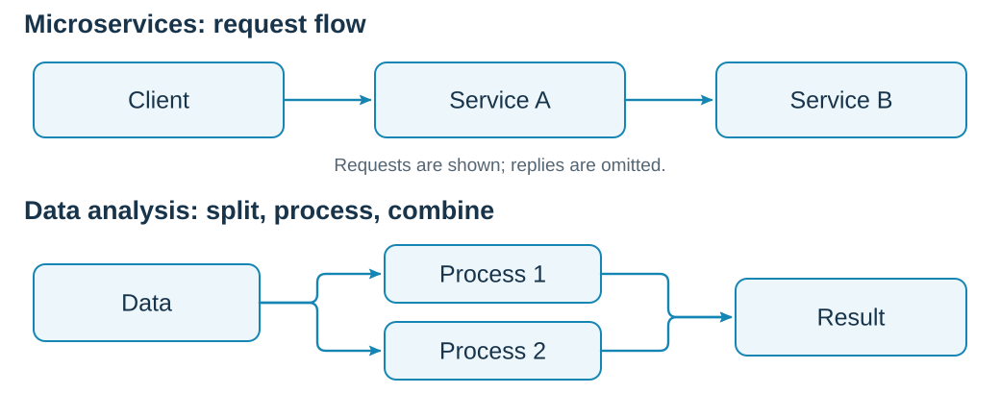
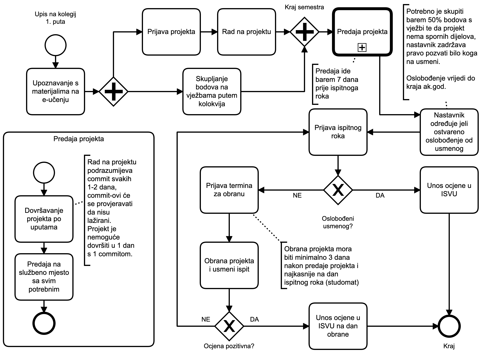
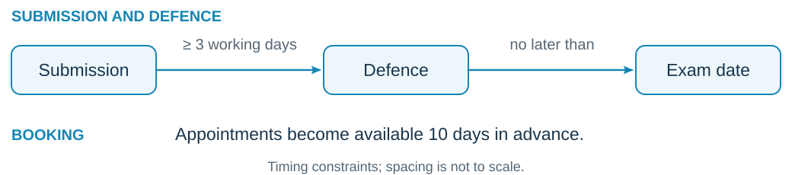
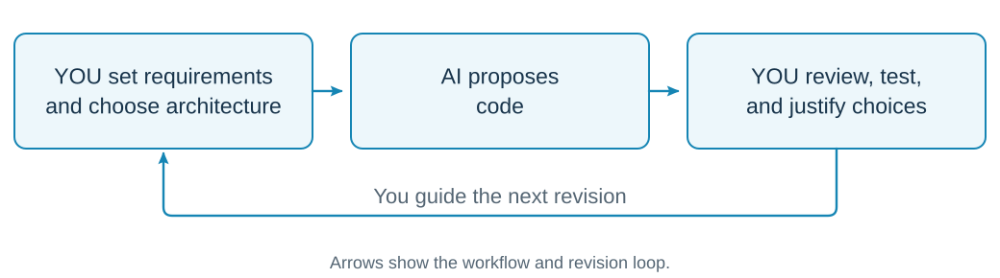

## Attendance and participation {.stock-slide}

:::: {.columns}
::: {.column width="52%"}
**Attendance is optional.**

If you attend, take an active part:

- Ask questions.
- Compare alternatives.
- Explain your decisions.

Use the QR code on the next slide to record your presence.
:::
::: {.column width="43%"}
{fig-alt="A teacher explaining ideas on a board."}

:::
::::

::: {.notes}
Timing: 00:30–01:30 min (1 minute).

Explain that attendance is optional. Ask attending students to use the QR code or link on the next slide. Encourage questions, participation in discussions, and explanations of their reasoning.
:::

## Mark your presence {#attendance .attendance-slide}

::: {.attendance-content}

{width=455.4 height=455.4 fig-alt="QR code for marking your presence"}

[http://bit.ly/rs-tu-sam](http://bit.ly/rs-tu-sam)

:::

::: {.notes}
Timing: 01:30–02 min (30 seconds, after the attendance explanation). Ask students to mark their presence. This check-in does not by itself establish an attendance requirement.
:::

## Teaching staff and course obligations

| Course component | In charge |
|:---|:---|
| Lectures (Predavanja) | assoc. prof. Nikola Tanković, PhD |
| Practical classes (Vježbe) | Luka Blašković, mag. inf. |

**Course obligations are organised separately for lectures and practical classes.**

Follow the requirements announced for each component.

::: {.notes}
Timing: 02–03 min (1 minute).

Introduce Nikola as responsible for lectures and Luka as responsible for practical classes. Explain that students should follow the obligations announced for each component.
:::

## What this course is about {.stock-slide}

:::: {.columns}
::: {.column width="48%"}
**Understand the concepts. Build systems. Explain your decisions.**

- Participants, messages, and shared state
- Failures, ordering, and coordination
- Theory applied through programming
:::
::: {.column width="47%"}
{.server-photo fig-alt="Rows of interconnected server racks in an imgix data centre."}

:::
::::

::: {.notes}
Timing: 03–04 min (1 minute).

Connect theoretical understanding with building distributed systems through practical programming exercises. Ask students which distributed applications they already use.
:::

## The route through the course

| Stage | Main questions |
|:---|:---|
| Foundations and communication | Who talks to whom? What can fail? |
| Time, replication, and consensus | What happened first? What can we agree on? |
| Recovery, workflows, and scale | How do we recover and grow? |
| Security and architecture review | What guarantees can the system provide, and under which assumptions? |

::: {.notes}
Timing: 04–06 min (2 minutes).

Present the course sequence at a high level, linking each stage to its main question. The first technical lecture begins with a timeout during project submission.
:::

## From lectures to practical work {.visual-slide .project-work-slide}

**Project work:**

Define the problem → Propose a solution → Implement → Test and refine

{width=1040 fig-alt="Two examples: a client sends requests through two services; data is split across two processes and combined into a result."}

::: {.notes}
Timing: 06–07 min (1 minute).

This process describes project work and also applies to practical-class tasks. First define the problem and expected behaviour, propose a solution, implement it, then test and refine it. Revisit earlier steps as needed.

Use these practical examples to connect lecture concepts with implementation: synchronous and asynchronous microservice communication, and distributed data analysis.
:::

## Project preparation

Be ready to use and explain:

- **Python basics:** collections, control flow, functions, modules, and classes
- **Python tools:** comprehensions, lambdas, keyword arguments, and default values
- **Concurrency:** `asyncio`, `async` / `await`, thread and process pools
- **Web services:** FastAPI, `httpx`, and Uvicorn
- **Containers and orchestration:** Docker Compose and Docker Swarm
- **Your dependencies:** package installation, requirements, and every library used in your project

::: {.notes}
Timing: 07–08 min (1 minute).
Use this as a preparation checklist. Collections include dictionaries, lists, sets, tuples, and named tuples. Students should understand class methods, asynchronous functions, and datetime where used. Connect this preparation to the AI policy: using a tool does not remove responsibility for understanding its output and dependencies.
Source: the course page, section “Potrebna znanja programskog jezika Python”, reviewed 2026-09-17: https://fiputreca.notion.site/Raspodijeljeni-sustavi-544564d5cc9e48b3a38d4143216e5dd6.
:::

## Course information and help {.stock-slide}

:::: {.columns}
::: {.column width="63%"}
**Course materials**

[E-Učenje](https://moodle.srce.hr/) · [Course web page](https://ntankovic.unipu.hr/rs)

<a class="recording-link" href="https://www.youtube.com/playlist?list=PLIeA2EYS12RVaj1GdVP4fkNrLiK5k6VD-">All lectures recorded — watch the playlist</a>

**Before asking:** consult the course materials.

**Google Chat: “FIPU RS”** is the first channel for all questions. Avoid email.
:::
::: {.column width="32%"}
{fig-alt="A student watching an online lesson beside books and notes."}

:::
::::

::: {.notes}
Timing: 08–09 min (1 minute).
Point students to E-Učenje, the course web page, and the linked YouTube playlist. All lectures are recorded on YouTube; students can revisit explanations before asking a question. Students should consult the course materials before asking. Direct all course questions first to Google Chat, in “FIPU RS”; email is not the preferred channel. For technical questions, ask for the expected result, actual result, and a small reproducible example.
:::

## How to pass the course (BPMN) {.exam-process}

{height=560 .lightbox fig-alt="Izvorni BPMN hodogram polaganja kolegija: projekt, bodovi s vježbi, predaja, oslobođenje od usmenog, obrana, unos ocjene i ponovna prijava."}

::: {.notes}
Timing: 09–12 min (3 minutes).

Click the image to enlarge it. Explain the parallel gateway (+), the exclusive decision (X), and the arrows indicating sequence.
Exemption requires at least 50% of practical-class points and no disputed project parts; the lecturer may still call any student to the oral exam. Exemption lasts until the end of the academic year. Without exemption, the defence must be at least 3 working days after project submission and no later than the registered exam date. A negative grade returns to exam registration. Project work requires commits every 1–2 days; commit authenticity is checked. The 50% threshold concerns exemption, not the overall course grade.
Source: lecturer-supplied hodogram_rs.png, 2026-09-17.
:::

## Submission, exemption, and defence {.visual-slide}

{width=1040 fig-alt="Defence is at least 3 working days after submission and no later than the exam date. Appointments become available 10 days in advance."}

[Book: ntankovic.unipu.hr/termin](https://ntankovic.unipu.hr/termin)

::: {.exemption-summary}
**Exemption:** ≥50% of practical points, no disputed project parts, and lecturer approval. The lecturer may still call anyone to the oral exam. Valid until the academic year ends. **Register for an exam date and note your exemption.**
:::

::: {.notes}
Timing: 12–13 min (1 minute).
Recap the rules shown in the BPMN. Project work and practical-class points progress in parallel. Complete the project according to the instructions and submit all required material to the official submission location. Work includes commits every 1–2 days, with authenticity checks; a one-day project with one commit does not satisfy the stated process.
The 50% practical-points threshold is a condition for oral-exam exemption, not a formula for the overall course grade. The lecturer decides exemption and retains the right to call any student to the oral exam. Registration for an exam date is required on both paths. Exempt students must note that they are exempt. Book appointments at https://ntankovic.unipu.hr/termin; appointments become available 10 days in advance. With exemption, the grade is entered in ISVU. Without exemption, book the defence, defend the project, and take the oral exam. A positive result leads to grade entry in ISVU on the defence day; a negative result returns to exam-date registration.
Source: lecturer-supplied hodogram_rs.png, clarified 2026-09-17.
:::

## Prepare to explain your project

A useful practice checklist:

- Demonstrate the normal flow.
- Explain service boundaries and messages.
- Show what happens when something fails.
- Justify one design choice and its tradeoff.

**Practise explaining why your code behaves as it does.**

::: {.notes}
Timing: 13–16 min (3 minutes).

Use the timeout example: how would you explain whether a project submission was accepted? Ask students to connect the observed behaviour to code and architectural decisions. A successful demonstration alone does not explain the reasoning.
:::

## AI use and your responsibility {.visual-slide}

**AI is allowed.** Use technologies taught in lectures or approved by the professor.

{width=1040 fig-alt="You choose requirements and architecture, AI proposes code, and you review, test, and justify choices. You direct subsequent revisions."}

Understand **every line of code**. Defend each choice, its alternatives, and tradeoffs.

**Architecture is a set of informed choices. Prove yours.**

::: {.notes}
Timing: 16–18 min (2 minutes).

Students may use AI, but must direct it toward technologies taught in lectures or approved by the professor. They remain responsible for understanding every part of the resulting code and demonstrating that they guided the architecture.
Ask a student to explain any part of the code and connect it to an architectural choice. Ask why they chose a technology or boundary, which alternatives they considered, and what consequences or tradeoffs follow. Students must be able to discuss and justify the choices themselves.
:::

## Before the first technical lecture

You should know:

- Where to find the confirmed course rules and materials
- What work is expected and how it will be assessed
- Where to ask questions

Next: **a 20 MB project upload times out. Should you submit again?**

::: {.notes}
Timing: 18–20 min (2 minutes).

Use the remaining time for questions about obligations, assessment, and getting help. Close with the timeout question that opens the first technical lecture.
:::
