## Evidencija prisutnosti {#attendance .attendance-slide}

::: {.attendance-content}
[{width=455 height=455 fig-alt="QR kod za evidenciju prisutnosti na kolegiju Web aplikacije."}](https://bit.ly/wa-tu-sam)

[bit.ly/wa-tu-sam](https://bit.ly/wa-tu-sam)
:::

::: {.notes}
Vrijeme: 0.5–1 min (0.5 min).
Ostavite pola minute za evidenciju putem QR koda ili poveznice.
:::

## Stranica se otvorila. Gdje su proizvodi? {#s01 .example-slide .opening-question}

{height=190 fig-alt="Sučelje trgovine prikazano je, ali popis proizvoda još pokazuje Učitavanje."}

Što smijemo zaključiti?

::: {.answer-chips}
[**A** Usluga za dohvat sigurno ne radi]{.answer-chip .answer-a}
[**B** Baza je prazna]{.answer-chip .answer-b}
[**C** Trebamo još dokaza]{.answer-chip .answer-c}
:::

::: {.notes}
Skripta: [Stranica se otvorila. Gdje su proizvodi?](chapter.hr.qmd#s01).
Vrijeme: 1–3 min (2 min).

Pitanje: Glasajte A/B/C i navedite jedan dokaz koji nedostaje.

Očekivano obrazloženje: C. Prihvatite opis običnim riječima: je li dohvat pokrenut, jesu li podaci stigli i je li ih sučelje prikazalo? Stručne nazive tek uvodimo.

:::

## Ishodi i predznanje {#s02 .outcomes-slide}

Nakon predavanja moći ćete:

1. **objasniti** kako preglednik traži podatke i prima odgovor [Razumijevanje]{.bloom .b2}
2. **protumačiti** metodu, status i zaglavlja jednostavne HTTP poruke [Razumijevanje]{.bloom .b2}
3. **skicirati** put zahtjeva od preglednika do baze i natrag [Primjena]{.bloom .b3}
4. **razlikovati** odgovornosti komponenti i mjesta na kojima je stanje [Analiza]{.bloom .b4}
5. **odabrati** dokaz koji razlikuje moguće uzroke kašnjenja ili ispada [Vrednovanje]{.bloom .b5}

::: {.prereq}
[Predznanje]{.prereq-label} JavaScript, razvoj frontenda i korištenje Firebasea. HTTP učimo od početka.
:::

::: {.notes}
Skripta: [Ishodi i predznanje](chapter.hr.qmd#s02).
Vrijeme: 3–4 min (1 min).

Pitanje: Kako biste objasnili razliku između prikaza u pregledniku i podataka koje treba dohvatiti?

Očekivano obrazloženje: Sučelje se može prikazati prije nego što podaci stignu. Način komunikacije tek uvodimo.

:::

## Što je Firebase radio za nas? {#firebase-polaziste .firebase-slide}

Poznati koraci: **klik → poziv Firebase biblioteke → podaci → prikaz**.

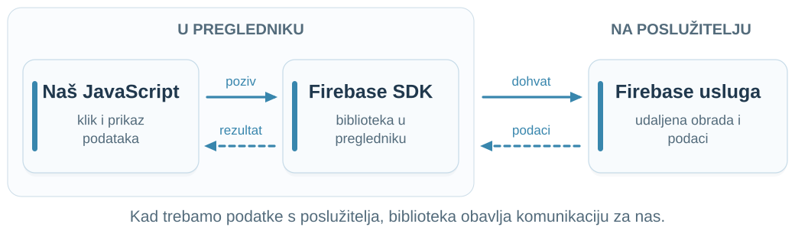{height=310 fig-alt="Naš JavaScript i Firebase SDK nalaze se u pregledniku. JavaScript poziva biblioteku, ona dohvaća podatke od udaljene Firebase usluge, a rezultat vraća našem kodu za prikaz."}

**Backend je program iza sučelja koji obrađuje zahtjeve i podatke.**

::: {.notes}
Skripta: [Što je Firebase radio za nas?](chapter.hr.qmd#firebase-polaziste).
Vrijeme: 4–6 min (2 min).

Pozovite studente da opišu dohvat koji su radili s Firebaseom, svojim riječima i bez pogađanja naziva funkcija. Pitajte: izvršava li se sav posao unutar komponente? Povežite lokalni poziv biblioteke s udaljenom uslugom. Ne uvodite TCP i ne tvrdite da Firebase uvijek šalje GET ili koristi isti transport. SDK je biblioteka koju pozivamo u kodu; udaljena usluga je program kojem se ona obraća.

Izvori: [Firebase: SDKs and client libraries](https://firebase.google.com/docs/firestore/client/libraries).
:::

## Kako je nastao web? {#web-povijest .history-slide}

**HTTP** = *HyperText Transfer Protocol*: pravila (*protocol*) za prijenos (*transfer*) teksta s poveznicama (*hypertext*).

```{=html}
<div class="timeline"><div class="tl-axis"></div><div class="tl-item up " style="left:8.33%"><div class="tl-card">Tim Berners-Lee u CERN-u predlaže sustav povezanih dokumenata.</div><div class="tl-dot"></div><div class="tl-year">1989.</div></div><div class="tl-item down " style="left:25.00%"><div class="tl-card">Na računalu NeXT rade prvi web-poslužitelj i preglednik.</div><div class="tl-dot"></div><div class="tl-year">1990.</div></div><div class="tl-item up key" style="left:41.67%"><div class="tl-card">HTTP/0.9: zahtjev je jedan redak <code>GET /putanja</code>, odgovor samo HTML.</div><div class="tl-dot"></div><div class="tl-year">1991.</div></div><div class="tl-item down " style="left:58.33%"><div class="tl-card">CERN daje softver za web (preglednik, poslužitelj) svima besplatno.</div><div class="tl-dot"></div><div class="tl-year">1993.</div></div><div class="tl-item up " style="left:75.00%"><div class="tl-card">HTTP/1.0 i HTTP/1.1: statusi, zaglavlja, različiti sadržaji.</div><div class="tl-dot"></div><div class="tl-year">1996.–1997.</div></div><div class="tl-item down now" style="left:91.67%"><div class="tl-card">HTTP/2 i HTTP/3 mijenjaju prijenos; značenje poruka ostaje isto.</div><div class="tl-dot"></div><div class="tl-year">danas</div></div></div>
```

::: {.notes}
Skripta: [Kako je nastao web?](chapter.hr.qmd#web-povijest).
Vrijeme: 6–9 min (3 min).

Rastavite akronim: hipertekst je tekst s poveznicama prema drugim dokumentima; transfer je prijenos; protokol su dogovorena pravila. Web je nastao kao sustav za razmjenu dokumenata među istraživačima, ne kao platforma za aplikacije. Istaknite točku 1991. (istaknuta na crti): cijeli zahtjev bio je jedan redak, bez statusa i zaglavlja; pogreška je bila samo HTML tekst za čovjeka. Sve što danas vidimo u Networku dodano je kasnije jer su aplikacije trebale više od dokumenata. Točka 1993.: CERN je javno objavio osnovni preglednik, poslužitelj i zajedničku programsku biblioteku, bez naknade i bez licence; svatko je mogao napraviti vlastiti preglednik ili poslužitelj. Pitanje: zašto bi preglednik trebao znati je li zahtjev uspio, ako mu je dosta pokazati tekst? Ne ulazite u razlike HTTP/2 i HTTP/3.

Izvori: [CERN: A short history of the Web](https://home.cern/science/computing/the-birth-of-the-web/short-history-web/); [Berners-Lee: Information Management: A Proposal](https://www.w3.org/History/1989/proposal.html); [W3C: The Original HTTP as defined in 1991](https://www.w3.org/Protocols/HTTP/AsImplemented.html); [MDN: Evolution of HTTP](https://developer.mozilla.org/en-US/docs/Web/HTTP/Guides/Evolution_of_HTTP).
:::

## Prvi webovi: pogledajmo {#prvi-webovi .example-slide}

| **Poveznica** | **Što vidimo** |
|:----|:------|
| [info.cern.ch](https://info.cern.ch/hypertext/WWW/TheProject.html) | prva web stranica, CERN ju je obnovio 2013. |
| [line-mode.cern.ch](https://line-mode.cern.ch/www/hypertext/WWW/TheProject.html) | ista stranica u ranom tekstualnom pregledniku |
| [worldwideweb.cern.ch](https://worldwideweb.cern.ch/) | rekonstrukcija prvog preglednika (2019.) |
| [spacejam.com/1996](https://www.spacejam.com/1996/) | sačuvana stranica filma iz 1996. |

**Rani web bio je dokument s poveznicama: klik na poveznicu traži novi dokument.**

::: {.notes}
Skripta: [Prvi webovi: pogledajmo](chapter.hr.qmd#prvi-webovi).
Vrijeme: 9–12 min (3 min).

Otvorite prvu stranicu i kliknite dvije-tri poveznice; zatim simulator tekstualnog preglednika, gdje se poveznice biraju brojem. Rekonstrukciju preglednika iz 2019. samo pokažite; nemojte trošiti vrijeme na njezino sučelje. Space Jam pokazuje web sredinom 1990-ih: slike i okviri, ali i dalje stranice koje poslužitelj šalje gotove. Pitanje: što nedostaje u odnosu na današnju trgovinu? Očekivano: nema podataka koji se dohvaćaju nakon prikaza, prijave ni košarice; preglednik prikazuje dokument, a ne izvršava aplikaciju. Taj prijelaz vodi nas natrag na pitanje „Gdje su proizvodi?”. Ne tvrdite da sačuvane stranice odgovaraju izvorniku bajt po bajt: to su obnovljene ili sačuvane verzije.

Izvori: [CERN: info.cern.ch](https://info.cern.ch/); [CERN: Where the web was born](https://home.cern/science/computing/the-birth-of-the-web/where-web-was-born/); [CERN: WorldWideWeb rebuild](https://worldwideweb.cern.ch/).
:::

## HTTP: zahtjev i odgovor {#http-osnove}

**HTTP** je skup pravila za razmjenu poruka na webu.

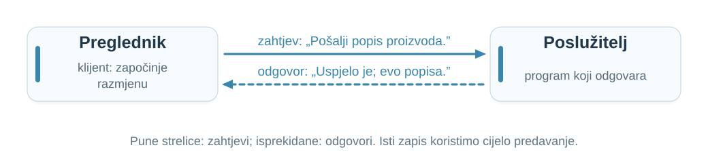{height=200 fig-alt="Preglednik kao klijent šalje zahtjev „Pošalji popis proizvoda.”; poslužitelj vraća odgovor „Uspjelo je; evo popisa.”"}

Preglednik je **klijent**: on započinje razmjenu zahtjevom (*request*); poslužitelj vraća odgovor (*response*).

Odgovor može sadržavati HTML, sliku ili podatke u **JSON** zapisu: tekstu u obliku JavaScript objekata i nizova.

::: {.notes}
Skripta: [HTTP: zahtjev i odgovor](chapter.hr.qmd#http-osnove).
Vrijeme: 12–15 min (3 min).

Akronim je objašnjen na slajdu o povijesti weba. Rečenice na slici objašnjavaju značenje; nisu stvarna HTTP sintaksa. Pokažite dvije strelice sa suprotnim smjerovima; isti zapis (puna strelica = zahtjev, isprekidana = odgovor) vraća se u svim kasnijim dijagramima. Pitajte tko šalje zahtjev, a tko odgovor. Očekivano: klijent, zatim poslužitelj. Statusne kodove uvodimo nakon ove osnovne slike.

Izvori: [MDN: Overview of HTTP](https://developer.mozilla.org/en-US/docs/Web/HTTP/Guides/Overview).
:::

## Prvi pogled u Network {#http-network .exercise-slide}

1. Otvorimo [dummyjson.com](https://dummyjson.com/), alate za razvoj (**F12**) i karticu **Network**: popis svih zahtjeva stranice.
2. Osvježimo stranicu: pogledajmo **Response** dokumenta.
3. Otvorimo [dummyjson.com/products](https://dummyjson.com/products).
4. U odgovoru pronađimo naziv i cijenu proizvoda.

**Prvi odgovor je HTML stranice, drugi JSON s podacima.**

::: {.notes}
Skripta: [Prvi pogled u Network](chapter.hr.qmd#http-network).
Vrijeme: 15–19 min (4 min).

Bez lokalne instalacije ili prijave. Alate otvorite prije osvježavanja; ostavite filtar All, ne Fetch/XHR. Nakon otvaranja /products odaberite redak products. Navigacija može očistiti prethodni popis; usporedbu ponovite povratkom na početnu stranicu. U JSON-u pronađite products, title i price. Ovo su testni podaci. Ne tvrdite da naslovnica automatski poziva upravo taj endpoint. Rezerva ako usluga ne radi: cd code/01-introduction, npm start i http://127.0.0.1:3000, gumb Dohvati proizvode. Lokalni niz nije isti oblik kao DummyJSON objekt s poljem products.

Izvori: [DummyJSON](https://dummyjson.com/); [Products](https://dummyjson.com/docs/products).
:::

## Adresa i putanja {#s10}

**URL je adresa resursa**, onoga što tražimo: dokumenta, slike ili popisa podataka.

`https://dummyjson.com/products`

| **Dio** | **Običnim riječima** |
|:---|:---|
| `https` | način pristupa, uz zaštitu prijenosa |
| `dummyjson.com` | kojem se odredištu obraćamo |
| `/products` | što tražimo u toj aplikaciji |

Putanja ne mora označavati datoteku na disku.

::: {.notes}
Skripta: [Adresa i putanja](chapter.hr.qmd#s10).
Vrijeme: 19–21 min (2 min).

Pitanje: Koji dio adrese označava odredište, a koji proizvode?

Očekivano obrazloženje: dummyjson.com je ime odredišta; /products je putanja. Metodu uvodimo uz prvi zahtjev.


Izvori: [RFC 9110: HTTP Semantics](https://www.rfc-editor.org/rfc/rfc9110.html).
:::

## Kako pronaći odredište: DNS {#s15 .dns-slide}

**Domensko ime:** `dummyjson.com` · **IP adresa:** mrežna adresa odredišta.

**FQDN** = potpuni domenski naziv (*Fully Qualified Domain Name*).

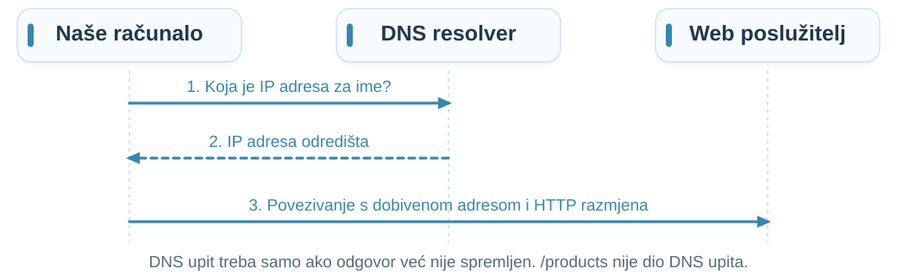{height=320 fig-alt="DNS resolver vraća IP adresu za domensko ime; računalo se zatim povezuje s web poslužiteljem. DNS ne obrađuje putanju /products."}

**DNS povezuje ime s adresom.** Resolver je usluga koja pronalazi taj odgovor.

::: {.notes}
Skripta: [Kako pronaći odredište: DNS](chapter.hr.qmd#s15).
Vrijeme: 21–23 min (2 min).

Kratko objasnite FQDN: potpuni naziv je dummyjson.com.; završna točka označava korijen i obično se izostavlja u URL-u. Naziv ne uključuje protokol ni putanju. Adresa može biti IPv4 ili IPv6; jedno ime može imati više adresa. Resolver koristi predmemoriju ili druge DNS poslužitelje.

Pitanje: Rješava li DNS putanju /products?

Očekivano obrazloženje: Ne. Razrješava ime, dok putanju obrađuje HTTP infrastruktura/aplikacija.


Izvori: [MDN: DNS](https://developer.mozilla.org/en-US/docs/Glossary/DNS).
:::

## Zahtjev koji pratimo {#s09}

**`GET` = dohvati · `/products` = putanja do proizvoda**

```http
GET /products HTTP/1.1
Host: dummyjson.com
Accept: application/json
```

**Zaglavlja** su dodatni podaci: `Host` navodi odredište, a `Accept` prihvatljiv format odgovora.

Čitljiv primjer HTTP/1.1; ovaj zahtjev nema tijelo.

::: {.notes}
Skripta: [Zahtjev koji pratimo](chapter.hr.qmd#s09).
Vrijeme: 23–25 min (2 min).

Pitanje: Šalje li se kod naše komponente poslužitelju uz ovaj zahtjev?

Očekivano obrazloženje: Ne. Šalje se poruka; backend ne izvršava komponentu.


Izvori: [RFC 9110: HTTP Semantics](https://www.rfc-editor.org/rfc/rfc9110.html); [MDN: Accept](https://developer.mozilla.org/en-US/docs/Web/HTTP/Reference/Headers/Accept).
:::

## Metoda opisuje namjeru {#s11 .methods-slide}

::: {.methods}
- [GET]{.verb .get} dohvat podataka o resursu [samo čita]{.mtag .read}
- [POST]{.verb .post} obrada poslanog sadržaja [mijenja stanje]{.mtag}
- [PUT]{.verb .put} stvaranje ili potpuna zamjena resursa [mijenja stanje]{.mtag}
- [PATCH]{.verb .patch} djelomična izmjena [mijenja stanje]{.mtag}
- [DELETE]{.verb .delete} uklanjanje resursa iz dostupnog sučelja [mijenja stanje]{.mtag}
:::

::: {.method-rule}
`GET /products` **ne smije naručivati proizvod.**
:::

::: {.notes}
Skripta: [Metoda opisuje namjeru](chapter.hr.qmd#s11).
Vrijeme: 25–28 min (3 min).

Pitanje: Ako promijenimo naziv metode u GET, postaje li operacija automatski sigurna?

Očekivano obrazloženje: Ne. Kod i ugovor moraju odgovarati semantici.


Izvori: [MDN: HTTP request methods](https://developer.mozilla.org/en-US/docs/Web/HTTP/Reference/Methods).
:::

## Odgovor: status, zaglavlja, tijelo {#s12}

```http
HTTP/1.1 200 OK
Content-Type: application/json

{"products":[{"id":1,"title":"Essence Mascara Lash Princess"}]}
```

**200** = uspjeh · **Content-Type** = format tijela

Iza praznog retka počinju podaci: **tijelo odgovora**.

Prikazana su samo izdvojena polja odgovora DummyJSON-a.

::: {.notes}
Skripta: [Odgovor: status, zaglavlja, tijelo](chapter.hr.qmd#s12).
Vrijeme: 28–30 min (2 min).

Pitanje: Može li nakon 200 OK sučelje ostati prazno zbog greške u JavaScriptu?

Očekivano obrazloženje: Da. Status nije potvrda uspješnog prikaza.


Izvori: [MDN: HTTP response status codes](https://developer.mozilla.org/en-US/docs/Web/HTTP/Reference/Status); [MDN: Content-Type](https://developer.mozilla.org/en-US/docs/Web/HTTP/Reference/Headers/Content-Type).
:::

## Skupine statusa i granice zaključka {#s13}

| **Status** | **Značenje** |
|:---|:---|
| `200 OK` | zahtjev je uspio |
| `404 Not Found` | traženi resurs nije pronađen |
| `503 Service Unavailable` | usluga trenutačno nije dostupna |
| Nema odgovora | još nemamo HTTP status za tumačenje |

Prva znamenka grupira ishode: **2xx uspjeh, 4xx problem zahtjeva, 5xx problem poslužitelja**.

::: {.notes}
Skripta: [Skupine statusa i granice zaključka](chapter.hr.qmd#s13).
Vrijeme: 30–32 min (2 min).

Pitanje: Je li 404 isto što i potpuni izostanak odgovora?

Očekivano obrazloženje: Ne. Neka komponenta je vratila HTTP odgovor; treba utvrditi koja.


Izvori: [MDN: HTTP response status codes](https://developer.mozilla.org/en-US/docs/Web/HTTP/Reference/Status).
:::

## 20 HTTP statusa po obiteljima {#http-status-map .status-map-slide}

:::: {.status-families}
::: {.status-family .family-1}
**1xx · Informacija**

Privremena poruka; obrada se nastavlja.

[`100` Continue]{.status-tag} [`101` Switching Protocols]{.status-tag}
:::
::: {.status-family .family-2}
**2xx · Uspjeh**

Zahtjev je prihvaćen ili uspješno obrađen.

[`200` OK]{.status-tag} [`201` Created]{.status-tag} [`202` Accepted]{.status-tag} [`204` No Content]{.status-tag}
:::
::: {.status-family .family-3}
**3xx · Preusmjeravanje**

Drugo odredište ili uporaba spremljenog sadržaja.

[`301` Moved Permanently]{.status-tag} [`302` Found]{.status-tag} [`304` Not Modified]{.status-tag} [`307` Temporary Redirect]{.status-tag}
:::
::: {.status-family .family-4}
**4xx · Problem zahtjeva**

Zahtjev nije moguće prihvatiti u ovom obliku ili kontekstu.

[`400` Bad Request]{.status-tag} [`401` Unauthorized]{.status-tag} [`403` Forbidden]{.status-tag} [`404` Not Found]{.status-tag} [`409` Conflict]{.status-tag} [`429` Too Many Requests]{.status-tag}
:::
::: {.status-family .family-5}
**5xx · Problem poslužitelja**

Poslužitelj ne može ispuniti zahtjev.

[`500` Internal Server Error]{.status-tag} [`502` Bad Gateway]{.status-tag} [`503` Service Unavailable]{.status-tag} [`504` Gateway Timeout]{.status-tag}
:::
::::

::: {.notes}
Vrijeme: 32–34 min (2 min).

Odabrani poznati statusi, ne statistička rang-lista. 202 znači prihvaćeno, ne dovršeno; 204 nema tijelo. 304 koristi spremljeni sadržaj, nije nova stranica. 401 traži valjanu autentikaciju, 403 odbija pristup. Gateway je poslužitelj-posrednik; njegovu ulogu obrađujemo kasnije. 502 znači nevaljan odgovor drugog poslužitelja, 504 istek čekanja na njega. 101 je promjena protokola, bez detalja mehanizma.

Izvor: [MDN: statusi](https://developer.mozilla.org/en-US/docs/Web/HTTP/Reference/Status).
:::

## Accept i Content-Type {#s14 .content-type-slide}

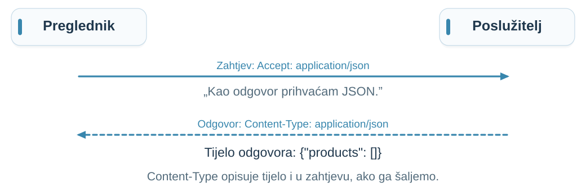{height=340 fig-alt="Preglednik navodi prihvatljiv format u Accept; poslužitelj opisuje format tijela odgovora s Content-Type."}

Zaglavlje **opisuje format** — ne pretvara HTML ili objekt u JSON.

Pregled čestih zaglavlja nalazi se na kraju predavanja.

::: {.notes}
Skripta: [Accept i Content-Type](chapter.hr.qmd#s14).
Vrijeme: 34–36 min (2 min).

Pitanje: Može li Content-Type: application/json učiniti nevaljan tekst valjanim JSON-om?

Očekivano obrazloženje: Ne. Zaglavlje opisuje sadržaj, ne preoblikuje ga.


Izvori: [MDN: Content-Type](https://developer.mozilla.org/en-US/docs/Web/HTTP/Reference/Headers/Content-Type); [MDN: Accept](https://developer.mozilla.org/en-US/docs/Web/HTTP/Reference/Headers/Accept).
:::

## Naš nastavni backend {#s03}

**Dosad:** DummyJSON, tuđi gotov backend na internetu.<br>
**Od sada:** naš backend, Node.js program iz mape `code/01-introduction`.<br>
Pokretanje: `cd code/01-introduction`{.cmd} → `npm start`{.cmd} → `http://127.0.0.1:3000`

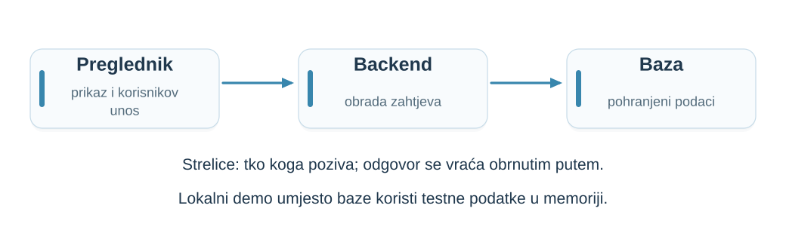{height=250 fig-alt="Početni model: preglednik šalje zahtjev backendu, a backend pristupa bazi."}

**API** je sučelje za programe: koje zahtjeve prihvaća i kakve odgovore vraća. Isti `/products`, drugi API: naš vraća niz, DummyJSON objekt s poljem `products`.

::: {.notes}
Skripta: [Naš nastavni backend](chapter.hr.qmd#s03).
Vrijeme: 36–38 min (2 min).

Recite izričito: dosad smo samo čitali odgovore tuđeg poslužitelja (DummyJSON) i ne znamo kako je iznutra građen. Od sada gledamo backend čiji kod imamo: mapa `code/01-introduction` u materijalima kolegija; pokreće se naredbama `cd code/01-introduction` i `npm start` (Node.js 20+, bez dodatnih paketa). Adresa 127.0.0.1 znači „ovo isto računalo”; nastavnikov backend studenti ne mogu otvoriti sa svojih računala, ali mogu pokrenuti vlastitu kopiju iz mape `code/01-introduction`. Baza je u ovom demu simulirana podacima u memoriji; pravu bazu dodajemo u 4. predavanju, a isti backend razvijamo kroz cijeli semestar. Lokalni /products vraća niz s id, name i price; DummyJSON objekt s products i title.

Pitanje: Može li jedno računalo sadržavati više prikazanih okvira?

Očekivano obrazloženje: Da. Ovdje su preglednik i backend na istom prijenosniku. Logičke odgovornosti i procesi nisu isto što i fizički strojevi.


Izvori: [MDN: Overview of HTTP](https://developer.mozilla.org/en-US/docs/Web/HTTP/Guides/Overview); [MDN: Proxy servers and tunneling](https://developer.mozilla.org/en-US/docs/Web/HTTP/Guides/Proxy_servers_and_tunneling).
:::

## Utipkajmo HTTP zahtjev ručno {#rucni-zahtjev .demonstration-slide .manual-http-slide}

Pokrenemo backend (`cd code/01-introduction`{.cmd}, zatim `npm start`{.cmd}), pa u drugom terminalu otvorimo vezu:

| **Sustav** | **Naredba** | **Napomena** |
|:--|:------|:---------|
| macOS | `nc -c 127.0.0.1 3000`{.cmd} | ugrađeno; s `-c` Enter šalje `\r\n` |
| Linux | `nc -C 127.0.0.1 3000`{.cmd} | OpenBSD netcat; s `-C` Enter šalje `\r\n` |
| Windows | `telnet 127.0.0.1 3000`{.cmd} | uključiti značajku Telnet Client |

:::: {.columns}
::: {.column width="45%"}
```http
GET /products HTTP/1.1
Host: 127.0.0.1

```
HTTP svaki redak završava s `\r\n`; prazan redak (još jedan Enter) završava zahtjev.
:::
::: {.column width="55%"}
- s `Host` → `200 OK` i JSON
- bez `Host` → `400 Bad Request`
- `GET /nesto` → `404 Not Found`
:::
::::

**HTTP poruka je tekst; preglednik i `fetch` pišu ga umjesto nas.**

::: {.notes}
Skripta: [Utipkajmo HTTP zahtjev ručno](chapter.hr.qmd#rucni-zahtjev).
Vrijeme: 38–42 min (4 min).

Prije sata: u jednom terminalu pokrenite `cd code/01-introduction` i `npm start`. U drugom otvorite vezu naredbom za svoj sustav. Utipkajte dva retka i zatim pritisnite Enter još jednom; bez praznog retka poslužitelj čeka nastavak zahtjeva. Prvo pošaljite ispravan zahtjev i pročitajte statusni redak, zaglavlja i tijelo: to je isto što Network prikazuje u karticama Headers i Response. Zatim ponovite bez retka Host (400) i s nepostojećom putanjom (404). Pitanje: tko je ovdje klijent? Očekivano: nc ili telnet; preglednik nije potreban.

Odgovor na HTTP/1.1 može sadržavati `Transfer-Encoding: chunked`; brojevi poput `2b` i `0` oko JSON-a su duljine dijelova, ne dio podataka. Veza ostaje otvorena dok se ne pošalje `Connection: close` ili dok poslužitelj ne istekne; prekinite s Ctrl+C.

Sustavi: macOS više nema telnet; ugrađeni `nc -c` šalje kraj retka CRLF, koji HTTP zahtijeva. Na Linuxu `-C` postoji u inačici netcat-openbsd (Debian, Ubuntu) i u `ncat`; tradicionalni netcat nema tu opciju, pa koristite `telnet` (`sudo apt install telnet`). Na Windowsu uključite Telnet Client (Turn Windows features on or off, ili kao administrator `dism /online /Enable-Feature /FeatureName:TelnetClient`). Windows telnet ne prikazuje utipkano: pritisnite Ctrl+], upišite `set localecho`, pa Enter za povratak. HTTPS se ovako ne može utipkati jer je promet šifriran; to objašnjavamo na slajdu o HTTPS-u. Naredbe za Linux i Windows nisu isprobane na nastavnom računalu; provjerite ih prije sata.

Izvori: [RFC 9112: HTTP/1.1](https://www.rfc-editor.org/rfc/rfc9112.html) (CRLF, Host, chunked); [RFC 9110: HTTP Semantics](https://www.rfc-editor.org/rfc/rfc9110.html).
:::

## Veza i port {#s16}

Naredbom `nc 127.0.0.1 3000`{.cmd} otvorili smo **vezu**. Što su ta dva broja?

**IP adresa** označava mrežno odredište; **port** uslugu na tom odredištu.

`127.0.0.1 3000` = ovo računalo, program koji sluša na portu 3000.

**TCP** uspostavlja vezu i prenosi bajtove redom.

HTTP opisuje poruke koje se tim putem razmjenjuju.

Danas pratimo TCP put, uobičajen za HTTP/1.1 i HTTP/2.

::: {.notes}
Skripta: [Veza i port](chapter.hr.qmd#s16).
Vrijeme: 42–44 min (2 min).

Pitanje: Je li uspostavljena TCP veza potvrda da proizvodi postoje?

Očekivano obrazloženje: Ne. Omogućuje prijenos, a sadržaj i ishod utvrđuje aplikacija.


Izvori: [MDN: TCP](https://developer.mozilla.org/en-US/docs/Glossary/TCP); [MDN: Overview of HTTP](https://developer.mozilla.org/en-US/docs/Web/HTTP/Guides/Overview).
:::

## Program, proces i računalo {#s04 .process-slide}

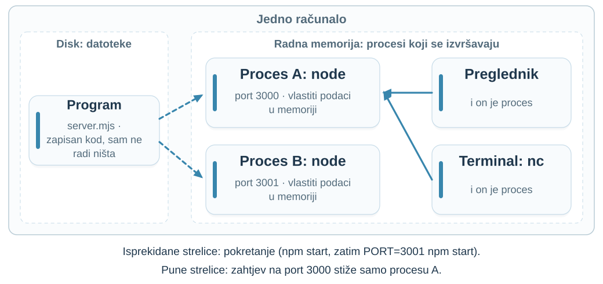{height=440 fig-alt="Jedno računalo: na disku je program server.mjs. Pokrenut dvaput, daje dva procesa u radnoj memoriji, A na portu 3000 i B na portu 3001, svaki s vlastitim podacima. Preglednik i nc također su procesi; zahtjev na port 3000 stiže samo procesu A."}

**Program** je datoteka s kodom; **proces** je jedno njegovo pokretanje. **Poslužitelj** je proces koji sluša na portu.

::: {.notes}
Skripta: [Program, proces i računalo](chapter.hr.qmd#s04).
Vrijeme: 44–47 min (3 min).

Pokažite uživo. Prvi terminal: u code/01-introduction pokrenite npm start (port 3000). Drugi terminal: PORT=3001 npm start (Windows PowerShell: $env:PORT=3001; npm start). Otvorite 127.0.0.1:3000 i 127.0.0.1:3001: isti program, dva procesa. Pokažite procese: macOS Monitor aktivnosti ili ps aux | grep node; Windows Upravitelj zadataka; Linux ps aux | grep node. Ugasite jedan proces s Ctrl+C: drugi i dalje odgovara, a datoteka server.mjs nije se promijenila. Istaknite da su i preglednik i nc procesi na istom računalu: računalo istodobno izvršava mnogo procesa.

Pitanje: Ako pokrenemo backend dvaput, dijele li procesi automatski istu JavaScript varijablu?

Očekivano obrazloženje: Ne. Svaki proces ima vlastitu memoriju; za zajedničko stanje potreban je izričit mehanizam, primjerice baza.
:::

## Handler je granica obrade {#s31}

**Handler** je funkcija koja obrađuje primljeni zahtjev.

**Ruta** povezuje metodu i putanju s tom funkcijom.

```javascript
// Pojednostavljeni prikaz odgovornosti, nije framework API.
async function listProducts() {
  const products = await readProducts();
  return { status: 200, body: products };
}
```

`readProducts()` dohvaća podatke; `await` čeka da budu spremni.

::: {.notes}
Skripta: [Handler je granica obrade](chapter.hr.qmd#s31).
Vrijeme: 47–49 min (2 min).

Pitanje: Koja funkcija dohvaća podatke, a koja priprema odgovor?

Očekivano obrazloženje: readProducts dohvaća podatke; listProducts određuje rezultat obrade. To su naše funkcije, ne ugrađene naredbe.

:::

## Okvir stranice i podaci stižu odvojeno {#s05 .two-phase-slide}

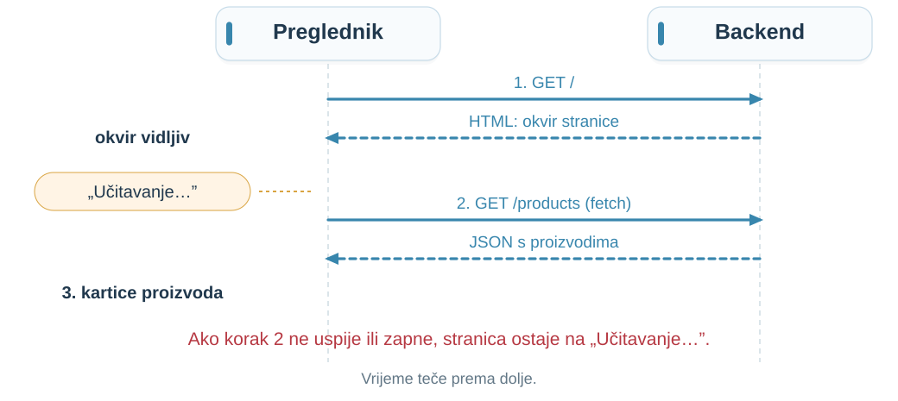{height=430 fig-alt="Slijed: 1. GET / vraća HTML okvir stranice, koja prikazuje Učitavanje; 2. JavaScript šalje GET /products i prima JSON; 3. prikazuju se kartice proizvoda. Ako korak 2 ne uspije, ostaje Učitavanje."}

**Korak 1 može uspjeti, a korak 2 ne: okvir stranice je vidljiv, proizvoda nema.**

::: {.notes}
Skripta: [Okvir stranice i podaci stižu odvojeno](chapter.hr.qmd#s05).
Vrijeme: 49–52 min (3 min).

Vratite se na uvodno pitanje „Stranica se otvorila. Gdje su proizvodi?”: odgovor je da je uspio korak 1, a za korak 2 tek treba provjeriti zahtjev /products. Na našem backendu: GET / vraća stranicu s gumbima, a klik na „Dohvati proizvode” šalje GET /products; u Networku su to dva retka. Ovako radi Vue aplikacija; poslužitelj može poslati i HTML u koji su proizvodi već upisani, ali to ovdje ne obrađujemo. Naš `index.html` ima ugrađenu skriptu, pa u Networku nema zasebnih `.js` i `.css` redaka; veće aplikacije ih imaju.

Pitanje: Koji Network redak govori o proizvodima: dokument (/) ili /products?

Očekivano obrazloženje: /products. Uspjeh dokumenta sam ne rješava pitanje API-ja.


Izvori: [MDN: Overview of HTTP](https://developer.mozilla.org/en-US/docs/Web/HTTP/Guides/Overview).
:::

## Naivan dohvat proizvoda {#s07 .example-slide}

`fetch` šalje zahtjev iz JavaScripta; zadana metoda je **GET**.

```javascript
const response = await fetch('/products');
products = await response.json();
```

`await` čeka rezultat; `.json()` čita tijelo kao JSON.

**Što prikazujemo tijekom čekanja, za `503` ili za `[]`?**

::: {.notes}
Skripta: [Naivan dohvat proizvoda](chapter.hr.qmd#s07).
Vrijeme: 52–56 min (4 min).

Pitanje: Hoće li fetch automatski baciti iznimku za svaki HTTP 404?

Očekivano obrazloženje: Ne. Treba provjeriti status/response.ok.


Izvori: [MDN: Using the Fetch API](https://developer.mozilla.org/en-US/docs/Web/API/Fetch_API/Using_Fetch).
:::

## Razlikuj stanja prikaza {#s08 .process-slide}

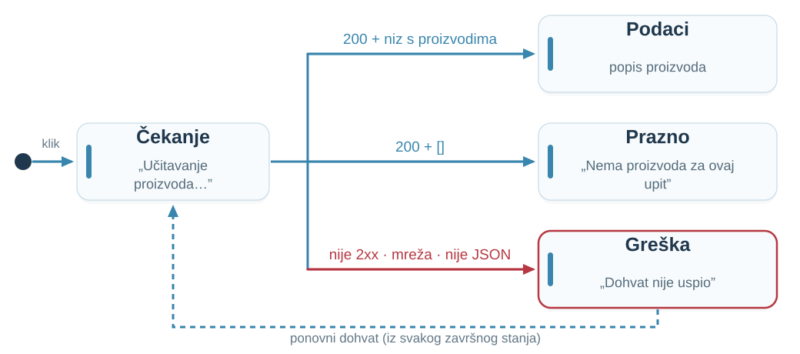{height=440 fig-alt="Dijagram stanja: klik vodi u Čekanje; odgovor 200 s proizvodima vodi u Podaci, 200 s praznim nizom u Prazno, a status koji nije 2xx, greška mreže ili neispravan JSON u Greška. Ponovni dohvat iz svakog završnog stanja vraća u Čekanje."}

**Prazna lista nije zamjena za grešku.**

::: {.notes}
Skripta: [Razlikuj stanja prikaza](chapter.hr.qmd#s08).
Vrijeme: 56–59 min (3 min).

Pitanje: Je li return [] u svakom catch bloku dobra obrada greške?

Očekivano obrazloženje: Ne: pretvara neuspjeh u privid uspješnog praznog odgovora.

:::

## Dohvat s eksplicitnom provjerom {#s30}

```javascript
loading = true;
error = null; products = [];
try {
  const r = await fetch('/products');
  if (!r.ok) throw new Error(`HTTP ${r.status}`);
  const data = await r.json();
  if (!Array.isArray(data)) throw new Error('Oblik podataka');
  products = data;
} catch (e) {
  error = 'Dohvat nije uspio';
} finally {
  loading = false;
}
```

Dio asinkrone funkcije; `products`, `loading` i `error` su stanje prikaza.

::: {.notes}
Skripta: [Dohvat s eksplicitnom provjerom](chapter.hr.qmd#s30).
Vrijeme: 59–63 min (4 min).

r.ok označava statuse 200–299. Kod čeka po jedan dohvat; timeout i otkazivanje još nisu ugrađeni. Primjer je tijelo asinkrone funkcije; products, loading i error prethodno su deklarirane varijable. Demonstracija dodatno provjerava polja proizvoda i ažurira prikaz.

Pitanje: Koje pretpostavke ovaj ispravak još nije uklonio?

Očekivano obrazloženje: Oblik svakog elementa, konkurentni pozivi i aktualnost podataka zahtijevaju dodatni dizajn.


Izvori: [MDN: Using the Fetch API](https://developer.mozilla.org/en-US/docs/Web/API/Fetch_API/Using_Fetch).
:::

## Isti zahtjev, četiri ishoda {#s33 .demonstration-slide .two-phase-slide}

Svaki gumb na našem backendu šalje `GET /products`; backend namjerno odgovara drukčije. Stranica koristi kod s prethodnog slajda.

| **Gumb** | **Odgovor backenda** | **Stanje prikaza?** |
|:-----|:------|:------|
| Dohvati proizvode | `200` i proizvodi | ? |
| Prazno | `200` i `[]` | ? |
| Pogreška poslužitelja | `503` | ? |
| Sporo | nakon 2 s: `200` i proizvodi | ? |

**Prema kodu predvidite: učitavanje, podaci, prazno ili greška? Zatim kliknemo i provjerimo.**

::: {.notes}
Skripta: [Isti zahtjev, četiri ishoda](chapter.hr.qmd#s33).
Vrijeme: 63–67 min (4 min).

Prije sata pokrenite backend (cd code/01-introduction, npm start) i provjerite sva četiri gumba. Neka studenti za svaki redak prate kod s prethodnog slajda: je li r.ok istinit, uspijeva li r.json(), je li rezultat niz. Zatim kliknite i pokažite stranicu, redak u Networku (Status, Response) i redak u terminalu backenda.

Očekivano: (1) podaci, „Proizvodi su dohvaćeni.”; (2) prazno, „Nema proizvoda za ovaj upit.”: status je uspješan, a niz prazan, pa to nije greška; (3) greška, „Dohvat nije uspio.” i HTTP 503, jer r.ok nije istinit; (4) dvije sekunde „Učitavanje proizvoda…”, zatim podaci. Dodatno, ako ima vremena: gumb „Neočekivan HTML” vraća 200, ali r.json() ne uspijeva, pa je stanje greška iako je status uspješan. Demo koristi testni niz, bez stvarne baze i proxyja. Gumb šalje /products?case=...; parametar case bira naš simulirani ishod, nije dio HTTP standarda. Promatrajte status i Response.

Pitanje: Što je različito između namjernog 503 i ugašenog procesa?

Očekivano obrazloženje: U prvom slučaju postoji HTTP odgovor, u drugom se ne mora dobiti nikakav odgovor.


Izvori: [Node.js: HTTP API](https://nodejs.org/api/http.html); [MDN: Using the Fetch API](https://developer.mozilla.org/en-US/docs/Web/API/Fetch_API/Using_Fetch).
:::

## HTTPS i granica zaštite {#s17}

Dosad je sve radilo na jednom računalu. Na internetu poruka prolazi tuđim mrežama:

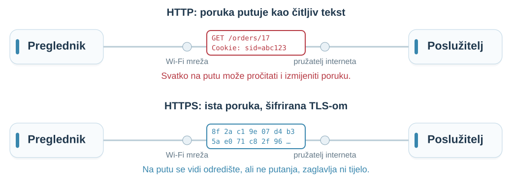{height=310 fig-alt="Ista poruka na putu kroz Wi-Fi mrežu i pružatelja interneta: preko HTTP-a je čitljiv tekst GET /orders/17 i Cookie, preko HTTPS-a šifrirani bajtovi; odredište se i dalje vidi."}

**HTTPS = HTTP + TLS: zaštita poruke na putu.** Certifikat pregledniku potvrđuje identitet poslužitelja.

TLS **ne provjerava** ovlasti korisnika, ispravnost cijene ni greške u kodu.

::: {.notes}
Skripta: [HTTPS i granica zaštite](chapter.hr.qmd#s17).
Vrijeme: 67–70 min (3 min).

Pitanje: Provjerava li HTTPS smije li korisnik vidjeti tuđu narudžbu?

Očekivano obrazloženje: Ne. To mora provjeriti aplikacija koja obrađuje zahtjev.


Izvori: [MDN: Transport Layer Security](https://developer.mozilla.org/en-US/docs/Web/Security/Defenses/Transport_Layer_Security).
:::

## Granica povjerenja {#s06}

TLS štiti poruku na putu, ali ne i ono što je klijent u nju upisao.

**Klijent šalje podatke koje može izmijeniti.**

- Preglednik pomaže korisniku ispuniti zahtjev.
- Backend odlučuje što je dopušteno.
- Baza provodi definirana ograničenja podataka.

Skriven gumb ne sprječava izravan API zahtjev.

::: {.notes}
Skripta: [Granica povjerenja](chapter.hr.qmd#s06).
Vrijeme: 70–72 min (2 min).

Pitanje: Ako se gumb Obriši ne prikazuje, može li zahtjev ipak stići?

Očekivano obrazloženje: Da. Potrebna je provjera dopuštenja u backendu; danas samo lociramo odgovornost.

:::

## Webshop: tko određuje cijenu? {#webshop-price .example-slide .webshop-slide}

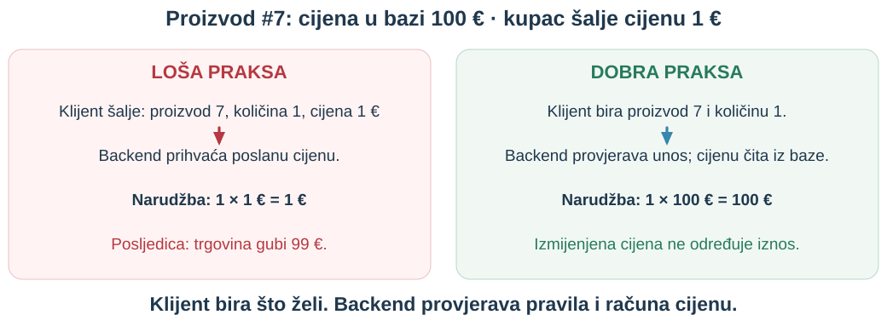{height=390 fig-alt="Loše: backend prihvaća izmijenjenu cijenu 1 euro i trgovina gubi 99 eura. Dobro: provjerava proizvod i količinu te računa iznos iz cijene 100 eura u bazi."}

Promjena prikaza sama ne mijenja bazu. **Problem nastaje ako backend povjeruje poslanom iznosu.**

::: {.notes}
Vrijeme: 72–74 min (2 min).

Pitajte: je li skriveno ili onemogućeno polje cijene zaštita? Nije. Korisnik kontrolira vlastiti klijent i može zaobići sučelje. U lošem primjeru poslana cijena postaje cijena narudžbe. U dobrom backend prihvaća identifikator proizvoda i količinu, provjerava da proizvod postoji, količina je dopuštena i korisnik smije naručiti, pa primjenjuje važeću cijenu i eventualne odobrene popuste. Dodatnu cijenu iz zahtjeva može odbiti ili zanemariti. Ovo nije potpuna implementacija naplate; zalihu i istodobne narudžbe obrađujemo kasnije.

Izvor: [OWASP: Input Validation](https://cheatsheetseries.owasp.org/cheatsheets/Input_Validation_Cheat_Sheet.html).
:::

## Reverse proxy je posrednik {#s18}

**Reverse proxy prima zahtjev preglednika i prosljeđuje ga backendu.**

Proxy može:

- završavati TLS i prosljeđivati zahtjeve
- usmjeravati prema jednom od backend procesa
- vratiti vlastitu pogrešku ako backend ne odgovori

**502**: nevaljan odgovor iza proxyja · **504**: istek čekanja na odgovor.

::: {.notes}
Skripta: [Reverse proxy je posrednik](chapter.hr.qmd#s18).
Vrijeme: 74–77 min (3 min).

Pitanje: Ako je proxy dostupan, mora li i backend biti dostupan?

Očekivano obrazloženje: Ne. Sudionici mogu imati različite ishode i kvarove.


Izvori: [MDN: Proxy servers and tunneling](https://developer.mozilla.org/en-US/docs/Web/HTTP/Guides/Proxy_servers_and_tunneling).
:::

## Jedan URL, više procesa {#s04a .process-slide}

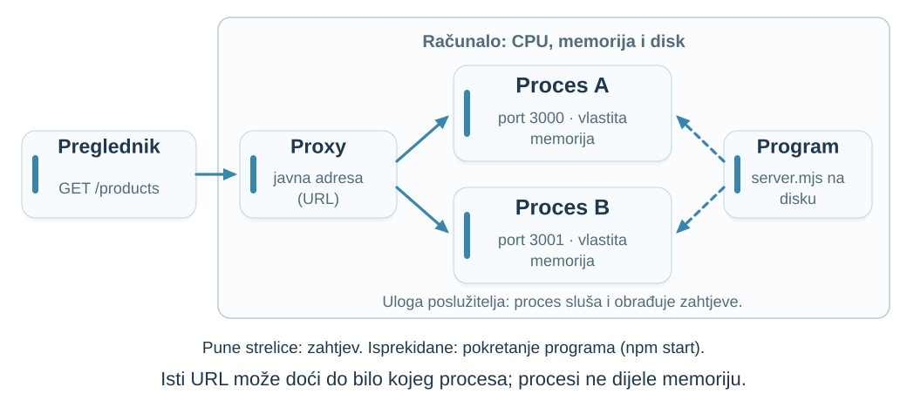{height=500 fig-alt="Preglednik šalje zahtjev proxyju na javnoj adresi; proxy ga prosljeđuje procesu A ili procesu B. Oba procesa pokrenuta su iz istog programa backend.mjs na istom računalu, a svaki ima vlastitu memoriju: n = 3 i n = 0."}

::: {.notes}
Skripta: [Reverse proxy je posrednik](chapter.hr.qmd#s18).
Vrijeme: 77–78 min (1 min).

Povežite s ranijim slajdom: ista dva procesa kao u demonstraciji (porti 3000 i 3001), ali sada ispred njih stoji proxy. Preglednik zna samo javnu adresu; proxy bira proces, a preglednik ne zna koji je odgovorio.

Pitanje: Ako proces A zapamti nešto u memoriji, hoće li to znati proces B kad sljedeći zahtjev stigne njemu?

Očekivano obrazloženje: Ne. Zato stanje koje mora vrijediti za sve zahtjeve ne smije živjeti samo u memoriji jednog procesa.

:::

## Slijed 1: preglednik šalje zahtjev {#s19}

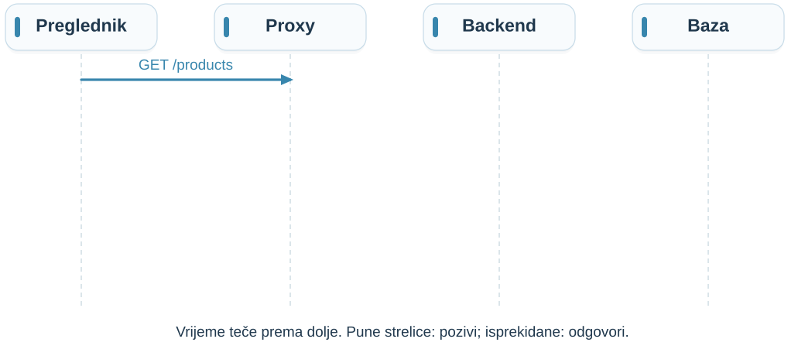{height=340 fig-alt="Prvi korak: preglednik šalje GET /products proxyju. Vrijeme teče prema dolje."}

JavaScript postavi `loading = true` i pokreće **`GET /products`**.

**Pretpostavke:** veza je dostupna; zanemarujemo predmemoriju (spremljenu kopiju odgovora); jedan zahtjev.

**Produkcijski model:** naš lokalni backend nema proxy, a bazu simulira u memoriji.

::: {.notes}
Skripta: [Slijed 1: preglednik šalje zahtjev](chapter.hr.qmd#s19).
Vrijeme: 78–80 min (2 min).

Pitanje: Koji sudionik trenutačno zna da je korisnik kliknuo?

Očekivano obrazloženje: Preglednik; ostali tek nakon primitka odgovarajuće poruke.

:::

## Slijed 2: backend traži podatke {#s20}

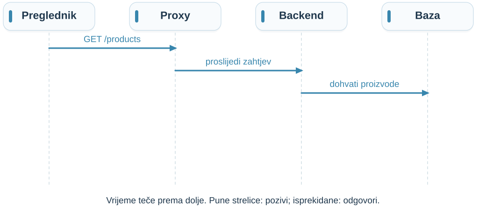{height=340 fig-alt="Proxy prosljeđuje zahtjev backendu, a backend traži proizvode iz baze."}

Proxy prosljeđuje poruku.

Backend odabire handler i traži proizvode iz baze.

**Čekanje baze nije isto što i slanje odgovora.**

::: {.notes}
Skripta: [Slijed 2: backend traži podatke](chapter.hr.qmd#s20).
Vrijeme: 80–82 min (2 min).

Pitanje: Gdje biste mjerili vrijeme upita?

Očekivano obrazloženje: Oko poziva prema bazi u backendu; odvojeno od ukupnog vremena klijenta.

:::

## Slijed 3: backend oblikuje odgovor {#s21}

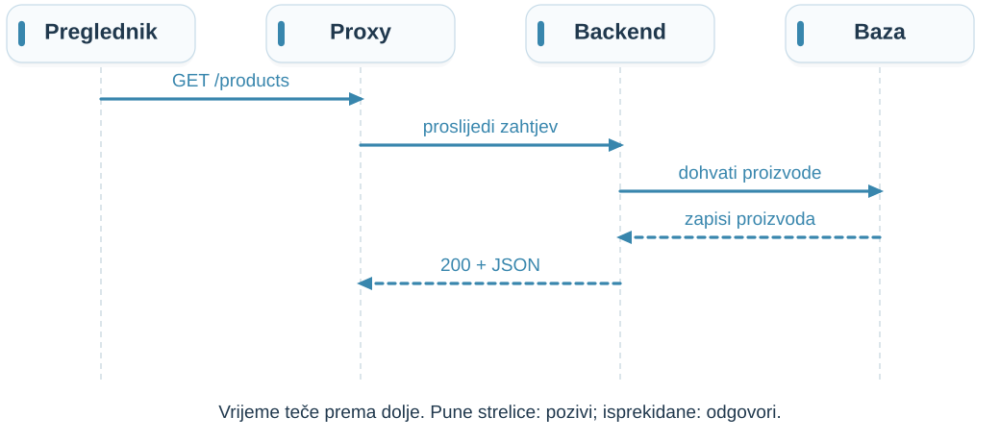{height=340 fig-alt="Baza vraća zapise backendu; backend šalje HTTP odgovor proxyju."}

Baza vraća zapise.

Backend odabire javna polja i pretvara podatke u JSON.

**Odgovor može sadržavati samo dio podataka iz baze.**

::: {.notes}
Skripta: [Slijed 3: backend oblikuje odgovor](chapter.hr.qmd#s21).
Vrijeme: 82–84 min (2 min).

Pitanje: Smije li frontend dobiti svako polje retka samo zato što postoji?

Očekivano obrazloženje: Ne. API izlaže odabranu reprezentaciju.

:::

## Slijed 4: prikaz se ažurira {#s22}

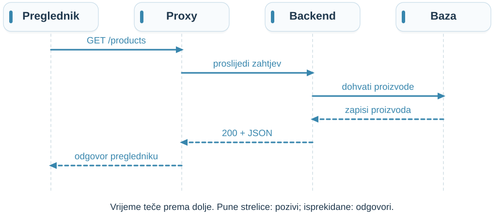{height=340 fig-alt="Potpuni put zahtjeva i odgovora kroz četiri komponente, uključujući povratak u preglednik."}

Preglednik prima status i tijelo.

Kod provjerava odgovor, čita JSON i ažurira stanje.

**Tek tada komponenta može prikazati proizvode.**

::: {.notes}
Skripta: [Slijed 4: prikaz se ažurira](chapter.hr.qmd#s22).
Vrijeme: 84–86 min (2 min).

Pitanje: Gdje tražimo problem ako Response ima proizvode, a prikaz ih nema?

Očekivano obrazloženje: U parsiranju, ugovoru podataka, stanju i prikazu; ne zaključujemo odmah da je baza kriva.

:::

## Gdje je stanje? {#s23}

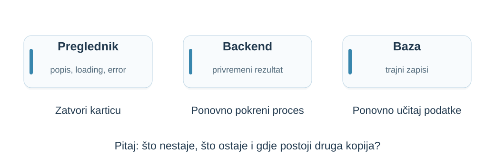{height=340 fig-alt="Tri mjesta stanja: preglednik, memorija backenda i trajni zapisi baze."}

**Zatvaranje kartice, restart procesa i gubitak podataka nisu isto.**

Za svaku vrijednost pitajte: tko je čuva, koliko dugo i gdje postoji druga kopija?

::: {.notes}
Skripta: [Gdje je stanje?](chapter.hr.qmd#s23).
Vrijeme: 86–89 min (3 min).

Pitanje: Koja bi vrijednost nestala pri restartu samo backend procesa?

Očekivano obrazloženje: Njegova privremena memorija; ne nužno trajni podaci baze niti stanje otvorenog preglednika.

:::

## Što znači HTTP stateless? {#s24}

::: {.definition number="1.1"}
HTTP je **stateless**: značenje zahtjeva ne oslanja se na obvezan prethodni dijalog koji HTTP pamti za tog klijenta.
:::

Aplikacija i dalje može imati **korisnike, košarice i sesije**. Kako, vidimo na sljedećem slajdu.

::: {.notes}
Skripta: [Što znači HTTP stateless?](chapter.hr.qmd#s24).
Vrijeme: 89–92 min (3 min).

Pitanje: Je li spremljena košarica dokaz da HTTP nije stateless?

Očekivano obrazloženje: Ne. To je aplikacijsko stanje, ne obvezni dijalog HTTP protokola.


Izvori: [RFC 9110: HTTP Semantics](https://www.rfc-editor.org/rfc/rfc9110.html).
:::

## Cookie prenosi kontekst {#s26}

**Sesija** povezuje zahtjeve, primjerice s istom prijavom korisnika.

**Cookie** je vrijednost koju preglednik pamti i šalje uz odgovarajuće zahtjeve.

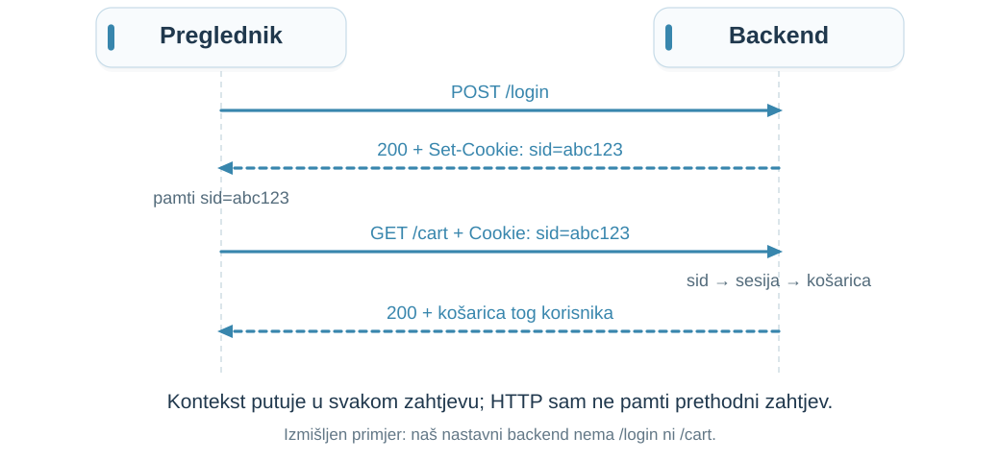{height=330 fig-alt="Slijed: POST /login, odgovor sa Set-Cookie sid=abc123; preglednik pamti sid; GET /cart s Cookie sid=abc123; backend preko sid pronalazi sesiju i vraća košaricu."}

::: {.notes}
Skripta: [Cookie prenosi kontekst](chapter.hr.qmd#s26).
Vrijeme: 92–96 min (4 min).

Pitanje: Dokazuje li samo prisutnost sid cookieja da je korisnik ovlašten za tuđi zapis?

Očekivano obrazloženje: Ne. Server provjerava sesiju i dopuštenja za konkretnu operaciju.


Izvori: [MDN: Using HTTP cookies](https://developer.mozilla.org/en-US/docs/Web/HTTP/Guides/Cookies).
:::

## Jedna TCP veza, više HTTP zahtjeva {#s25}

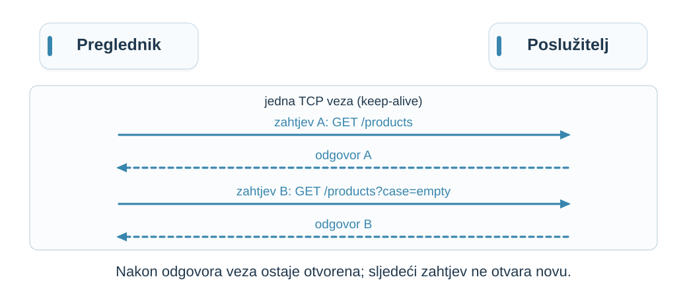{height=300 fig-alt="Dva zahtjeva i dva odgovora unutar iste otvorene TCP veze."}

- U `nc` vezi utipkajte drugi zahtjev odmah nakon prvog odgovora. Stiže kroz **istu vezu**.
- Odgovor kaže: `Connection: keep-alive` i `Keep-Alive: timeout=5`, pa neaktivnu vezu poslužitelj zatvara nakon 5 s.
- **Veza nije prijava korisnika.** Tko šalje zahtjev, aplikacija saznaje iz samog zahtjeva, ne iz veze.

::: {.notes}
Skripta: [Jedna TCP veza, više HTTP zahtjeva](chapter.hr.qmd#s25).
Vrijeme: 96–98 min (2 min).

Demonstracija (provjereno lokalno, macOS `nc -c`): otvorite `nc -c 127.0.0.1 3000`, pošaljite `GET /products HTTP/1.1` + `Host: 127.0.0.1` + prazan red, pa odmah zalijepite drugi zahtjev, npr. `GET /products?case=empty`. Oba odgovora stižu kroz istu vezu. Ručno tipkanje traje dulje od 5 s, pa drugi zahtjev pripremite za lijepljenje. Ako pričekate dulje od 5 s, veza se zatvori i `nc` završi; i to je korisno pokazati.

Napomena: u HTTP/1.1 veza ostaje otvorena prema zadanom; zaglavlje `Connection: keep-alive` potječe iz HTTP/1.0, a Node ga i dalje šalje. `timeout=5` je Nodeova zadana vrijednost (`server.keepAliveTimeout`, 5000 ms), ne pravilo HTTP-a.

Pitanje: Znači li nova TCP veza novu prijavu korisnika?

Očekivano obrazloženje: Ne. Preglednik ionako otvara više veza i zatvara ih kad hoće; identitet korisnika aplikacija prepoznaje iz podataka u zahtjevu (npr. kolačića), o čemu više kasnije.

Izvori: [MDN: Connection management in HTTP/1.x](https://developer.mozilla.org/en-US/docs/Web/HTTP/Guides/Connection_management_in_HTTP_1.x); [MDN: Keep-Alive](https://developer.mozilla.org/en-US/docs/Web/HTTP/Reference/Headers/Keep-Alive); [Node.js: server.keepAliveTimeout](https://nodejs.org/api/http.html#serverkeepalivetimeout).
:::

## CORS: odgovor i pristup iz JavaScripta {#s27}

**CORS** uređuje čitanje odgovora s drugog podrijetla.

Podrijetlo čine **način pristupa, ime odredišta i port**.

`http://localhost:5173` ≠ `http://localhost:3000`

`localhost` je ime za ovo računalo (`127.0.0.1`); 5173 je zadani port razvojnog poslužitelja Vite.

- Preglednik ograničava čitanje odgovora drugog podrijetla.
- CORS određuje dopušten pristup.
- CORS **ne provjerava tko je korisnik ni smije li čitati podatke**.

::: {.notes}
Skripta: [CORS: odgovor i pristup iz JavaScripta](chapter.hr.qmd#s27).
Vrijeme: 98–100 min (2 min).

Pitanje: Može li izravan klijent poslati zahtjev iako mu CORS ne dopušta browser pristup?

Očekivano obrazloženje: Da. Backend treba vlastite provjere; CORS nije zaštita od svih klijenata.


Izvori: [MDN: Cross-Origin Resource Sharing](https://developer.mozilla.org/en-US/docs/Web/HTTP/Guides/CORS).
:::

## CORS na primjeru: zahtjev stiže, čitanje ne {#s27a}

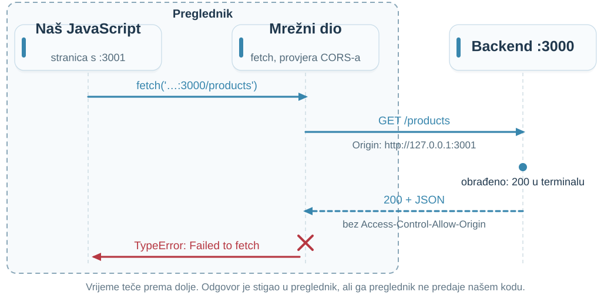{height=330 fig-alt="Slijed unutar preglednika i prema backendu: naš JavaScript sa stranice na portu 3001 poziva fetch; mrežni dio preglednika šalje GET s Origin zaglavljem; backend obradi zahtjev i vrati 200 bez Access-Control-Allow-Origin; mrežni dio preglednika našem kodu vraća TypeError."}

- Zahtjev **je stigao** i backend ga je obradio.
- Preglednik je primio odgovor, ali ga **ne predaje JavaScriptu**.
- Čitanje dopušta backend: `Access-Control-Allow-Origin: http://127.0.0.1:3001`.

::: {.notes}
Skripta: [CORS na primjeru: zahtjev stiže, čitanje ne](chapter.hr.qmd#s27a).
Vrijeme: 100–102 min (2 min).

Demonstracija (provjereno u headless Chromeu, Node v20.11.0): koristite dva procesa sa slajda „Program, proces i računalo” (`npm start` i `PORT=3001 npm start`). Otvorite `http://127.0.0.1:3001`, u konzoli razvojnih alata upišite `await fetch('http://127.0.0.1:3000/products')`. Konzola javlja: „blocked by CORS policy: No 'Access-Control-Allow-Origin' header is present”, a `fetch` završava s `TypeError: Failed to fetch`. Pokažite terminal procesa na portu 3000: zapisan je `GET /products` sa statusom 200.

Portovi 3001 i 3000 imaju istu ulogu kao Vite na 5173 i backend na 3000 s prethodnog slajda. `Origin` je zaglavlje koje preglednik sam dodaje: podrijetlo stranice s koje kod šalje zahtjev; JavaScript ga ne može proizvoljno postaviti.

Pitanje: Je li backend vratio grešku?

Očekivano obrazloženje: Ne. Vratio je 200; čitanje je blokirao preglednik jer odgovor nema dopuštenje za podrijetlo :3001. Zato poruku o CORS-u ne rješavamo na frontendu nego zaglavljem na backendu.

Napomena: ovo je jednostavan GET pa nema preflighta. Za druge zahtjeve (npr. JSON tijelo, vlastita zaglavlja) preglednik prvo šalje `OPTIONS` i bez dopuštenja ne šalje stvarni zahtjev.

Izvori: [MDN: Cross-Origin Resource Sharing](https://developer.mozilla.org/en-US/docs/Web/HTTP/Guides/CORS).
:::

## Gdje odlazi vrijeme? {#s28 .process-slide}

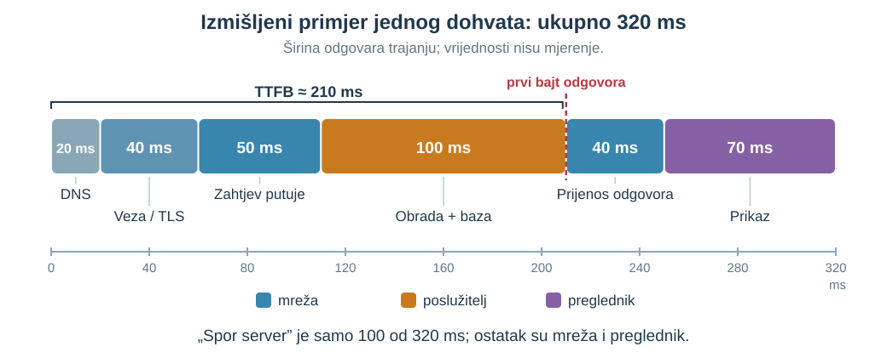{height=440 fig-alt="Izmišljeni vodopad jednog dohvata, ukupno 320 ms: DNS 20, veza/TLS 40 i zahtjev putuje 50 (mreža), obrada i baza 100 (poslužitelj), prijenos odgovora 40 (mreža), prikaz 70 (preglednik); TTFB oko 210 ms."}

**TTFB** (*Time to First Byte*) je vrijeme do prvog bajta odgovora.

Mjerimo određenu granicu; ne nazivamo sve „sporim serverom”.

::: {.notes}
Skripta: [Gdje odlazi vrijeme?](chapter.hr.qmd#s28).
Vrijeme: 102–104 min (2 min).

Pitanje: Je li vrijeme do prvog bajta jednako vremenu dohvata iz baze?

Očekivano obrazloženje: Ne. Obuhvaća širi put do prvog bajta.


Izvori: [MDN: Connection management in HTTP/1.x](https://developer.mozilla.org/en-US/docs/Web/HTTP/Guides/Connection_management_in_HTTP_1.x).
:::

## Bez odgovora: što se doista dogodilo? {#s29}

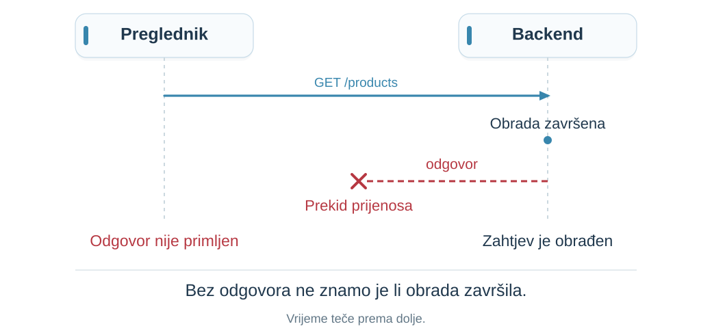{height=340 fig-alt="Backend je obradio zahtjev, ali odgovor ne stiže pregledniku; vrijeme teče prema dolje."}

Zahtjev može biti obrađen, a odgovor nečitljiv ili izgubljen.

**Istek čekanja govori da nismo dobili rezultat na vrijeme.**

Ne dokazuje da backend nije radio.

::: {.notes}
Skripta: [Bez odgovora: što se doista dogodilo?](chapter.hr.qmd#s29).
Vrijeme: 104–107 min (3 min).

Pitanje: Koji dokaz bi razlikovao izgubljen zahtjev od izgubljenog odgovora?

Očekivano obrazloženje: Povezani zapisi primitka i završetka obrade na serveru, uz oprez: odsutnost loga nije uvijek dokaz odsutnosti događaja.

:::

## Vježba: locirajte sljedeću provjeru {#s32 .exercise-slide}

| **Opažanje** | **Gdje biste dalje gledali?** |
|:---|:---|
| Nema `/products` u Networku | ? |
| `200`, tijelo `[]` | ? |
| `200`, proizvodi postoje, prikaz prazan | ? |
| Proxy vraća `504` | ? |
| Backend ima rezultat, preglednik javlja CORS | ? |

U paru: **hipoteza + dokaz koji je može opovrgnuti**.

::: {.notes}
Skripta: [Vježba: locirajte sljedeću provjeru](chapter.hr.qmd#s32).
Vrijeme: 107–111 min (4 min).

Pitanje: Za svaki redak odaberite jednu provjeru i jedno alternativno objašnjenje.

Očekivano obrazloženje: Prihvatiti različite provjere ako doista razlikuju hipoteze; tražiti opažanje koje bi promijenilo zaključak.

:::

## Provjera: tri česte zablude {#s34 .exercise-slide}

1. „HTTP je stateless pa aplikacija ne može pamtiti košaricu.”
2. „HTTPS znači da je korisnik ovlašten.”
3. „Server je vratio 200 pa se stranica ispravno prikazala.”

Za svaku tvrdnju ponudite **konkretan protuprimjer**.

::: {.notes}
Skripta: [Provjera: tri česte zablude](chapter.hr.qmd#s34).
Vrijeme: 111–113 min (2 min).

Pitanje: Navedite protuprimjer i komponentu koja određuje ishod.

Očekivano obrazloženje: Sesija/baza; backend ovlasti; klijentski prikaz. Ne pripisivati jamstvo pogrešnom sloju.

:::

## Sažetak jednog zahtjeva {#s35}

**Pronađi odredište → pošalji → obradi → vrati → prikaži.**

- Poruka ima namjeru, metapodatke i sadržaj.
- Stanje postoji na više mjesta.
- Veza, HTTP i sesija različiti su slojevi.
- Kašnjenje i kvar vežemo uz konkretnu granicu.

Početni spinner nije bio dovoljna dijagnoza.

::: {.notes}
Skripta: [Sažetak jednog zahtjeva](chapter.hr.qmd#s35).
Vrijeme: 113–115 min (2 min).

Pitanje: Objasnite put GET /products bez naziva frameworka.

Očekivano obrazloženje: Prihvatiti precizan opis odgovornosti, poruka i granica.

:::

## Osmislite sljedeći korak {#s36 .exercise-slide}

Dodajemo naručivanje: **`POST /orders`** šalje podatke za novu narudžbu.

| **Posao** | **Preglednik** | **Backend** | **Baza** |
|:-----|:-:|:-:|:-:|
| provjeriti unos (e-pošta, količina) | ? | ? | ? |
| odrediti cijenu | ? | ? | ? |
| provjeriti ima li dovoljno na zalihi | ? | ? | ? |
| spremiti narudžbu | ? | ? | ? |

**Tko radi koji posao? Smije li isti posao biti na više mjesta?**

Dodatni uvjet: baza kasni, a korisnik ponovno klikne **Naruči**.

::: {.notes}
Skripta: [Osmislite sljedeći korak](chapter.hr.qmd#s36).
Vrijeme: 115–118 min (3 min).

Parovi popune tablicu; više odgovora je obranjivo, tražite razlog za svaki.

Očekivano obrazloženje: Unos – preglednik pomaže korisniku (rano upozorenje), backend mora provjeriti jer klijent šalje što hoće. Cijena – backend iz pohranjenih podataka, nikad iz zahtjeva (Webshop). Zaliha – backend provjerava; baza može dodatno čuvati ograničenje (npr. zaliha ne smije biti negativna). Spremanje – backend traži, baza trajno pohranjuje. Dodatni uvjet: onemogućen gumb pomaže, ali nije zaštita; backend mora odlučiti što znači ponovljeni zahtjev (5. i 9. predavanje). Raspodjelu unutar backenda razrađujemo u 2. predavanju.

:::

## Pregled: 10 zaglavlja zahtjeva {#request-headers-map .header-map-slide}

**Odlazno: preglednik → poslužitelj**

:::: {.header-grid}
::: {.header-item}
**`Host`**

Odredište zahtjeva u HTTP/1.1.
:::
::: {.header-item}
**`Accept`**

Koje formate odgovora klijent prihvaća.
:::
::: {.header-item}
**`Accept-Language`**

Željeni jezici odgovora.
:::
::: {.header-item}
**`Accept-Encoding`**

Prihvatljivi načini sažimanja odgovora.
:::
::: {.header-item}
**`Content-Type`**

Format tijela koje klijent šalje.
:::
::: {.header-item}
**`Authorization`**

Podaci za provjeru identiteta/pristupa.
:::
::: {.header-item}
**`Cookie`**

Ranije spremljene vrijednosti za ovo odredište.
:::
::: {.header-item}
**`Origin`**

Podrijetlo zahtjeva: shema, host i port.
:::
::: {.header-item}
**`Referer`**

Adresa stranice s koje zahtjev potječe, ako se šalje.
:::
::: {.header-item}
**`User-Agent`**

Podaci o klijentskom programu.
:::
::::

::: {.notes}
Vrijeme: 118–118.5 min (0.5 min).

Ovo je pregled za prepoznavanje u Networku, ne popis za učenje napamet. Ne tražite razumijevanje svih mehanizama unaprijed; kolačiće, CORS i predmemoriju razrađujemo kasnije. Ne šalje se svako zaglavlje pri svakom zahtjevu. Dio zaglavlja postavlja preglednik, ne naš JavaScript. Content-Type može biti u oba smjera. Host se ovdje odnosi na HTTP/1.1; HTTP/2 i HTTP/3 koriste :authority.

Izvor: [MDN: HTTP zaglavlja](https://developer.mozilla.org/en-US/docs/Web/HTTP/Reference/Headers).
:::

## Pregled: 10 zaglavlja odgovora {#response-headers-map .header-map-slide}

**Dolazno: poslužitelj → preglednik**

:::: {.header-grid}
::: {.header-item}
**`Content-Type`**

Format tijela odgovora.
:::
::: {.header-item}
**`Content-Length`**

Veličina sadržaja u bajtovima, kad je navedena.
:::
::: {.header-item}
**`Content-Encoding`**

Kako je sadržaj sažet, npr. gzip.
:::
::: {.header-item}
**`Cache-Control`**

Pravila spremanja i ponovne uporabe odgovora.
:::
::: {.header-item}
**`ETag`**

Oznaka verzije sadržaja za kasniju provjeru.
:::
::: {.header-item}
**`Last-Modified`**

Vrijeme posljednje promjene sadržaja.
:::
::: {.header-item}
**`Location`**

Adresa za preusmjeravanje ili novostvoreni resurs.
:::
::: {.header-item}
**`Set-Cookie`**

Uputa pregledniku za spremanje kolačića.
:::
::: {.header-item}
**`WWW-Authenticate`**

Način provjere identiteta koji poslužitelj traži.
:::
::: {.header-item}
**`Access-Control-Allow-Origin`**

Koje podrijetlo smije čitati odgovor u pregledniku.
:::
::::

::: {.notes}
Vrijeme: 118.5–119 min (0.5 min).

Ovo je pregled za prepoznavanje u Networku, ne popis za učenje napamet. Ne tražite razumijevanje svih mehanizama unaprijed; kolačiće, CORS i predmemoriju razrađujemo kasnije. Ne šalje se svako zaglavlje pri svakom zahtjevu. Dio zaglavlja postavlja preglednik, ne naš JavaScript. Content-Type može biti u oba smjera. Host se ovdje odnosi na HTTP/1.1; HTTP/2 i HTTP/3 koriste :authority.

Izvor: [MDN: HTTP zaglavlja](https://developer.mozilla.org/en-US/docs/Web/HTTP/Reference/Headers).
:::

## Literatura: HTTP i preglednik {.references-slide}

- [RFC 9110: HTTP Semantics](https://www.rfc-editor.org/rfc/rfc9110.html)
- [MDN: Overview of HTTP](https://developer.mozilla.org/en-US/docs/Web/HTTP/Guides/Overview)
- [MDN: Using the Fetch API](https://developer.mozilla.org/en-US/docs/Web/API/Fetch_API/Using_Fetch)
- [MDN: Using HTTP cookies](https://developer.mozilla.org/en-US/docs/Web/HTTP/Guides/Cookies)
- [MDN: HTTP request methods](https://developer.mozilla.org/en-US/docs/Web/HTTP/Reference/Methods)
- [MDN: HTTP response status codes](https://developer.mozilla.org/en-US/docs/Web/HTTP/Reference/Status)

::: {.notes}
Vrijeme: 119–119.5 min (0.5 min).
Izvori su javno dostupni bez prijave. Za početno čitanje izdvojite MDN Overview; standard služi preciznoj provjeri semantike.
:::

## Literatura: put kroz sustav {.references-slide}

- [MDN: DNS](https://developer.mozilla.org/en-US/docs/Glossary/DNS)
- [MDN: TCP](https://developer.mozilla.org/en-US/docs/Glossary/TCP)
- [MDN: Transport Layer Security](https://developer.mozilla.org/en-US/docs/Web/Security/Defenses/Transport_Layer_Security)
- [MDN: Proxy servers and tunneling](https://developer.mozilla.org/en-US/docs/Web/HTTP/Guides/Proxy_servers_and_tunneling)
- [MDN: Connection management in HTTP/1.x](https://developer.mozilla.org/en-US/docs/Web/HTTP/Guides/Connection_management_in_HTTP_1.x)
- [MDN: Cross-Origin Resource Sharing](https://developer.mozilla.org/en-US/docs/Web/HTTP/Guides/CORS)
- [Node.js: HTTP API](https://nodejs.org/api/http.html)

::: {.notes}
Vrijeme: 119.5–120 min (0.5 min).
Izvori su javno dostupni bez prijave. Za početno čitanje izdvojite MDN Overview; standard služi preciznoj provjeri semantike.
:::
