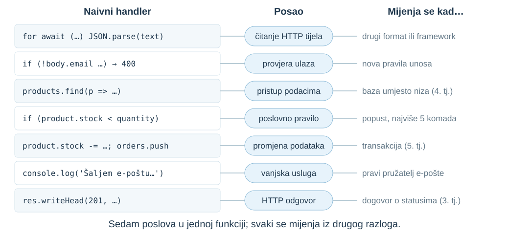
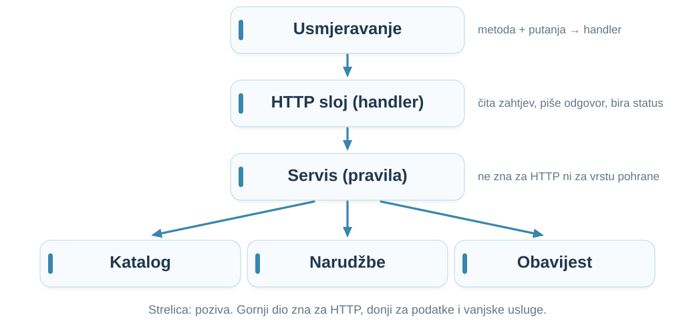
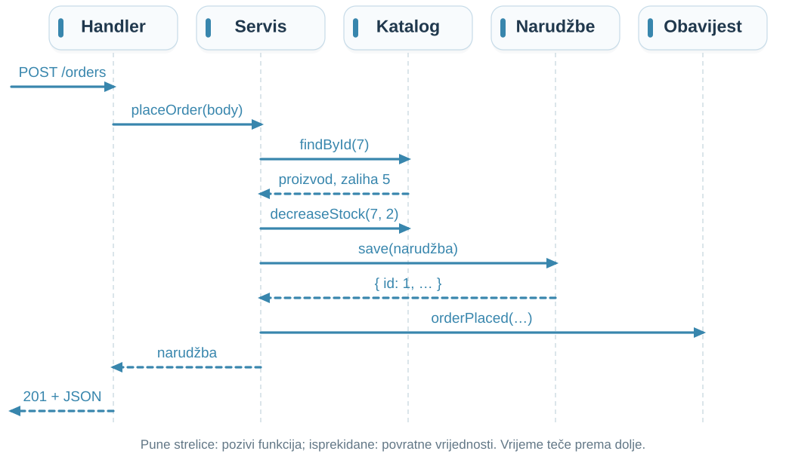
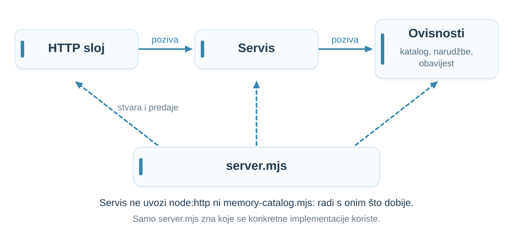
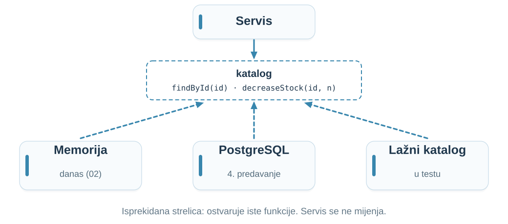
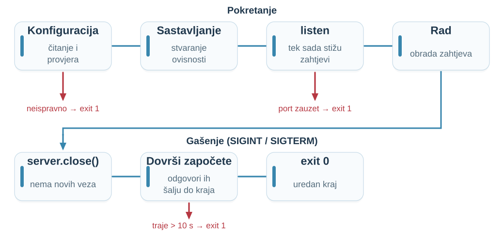
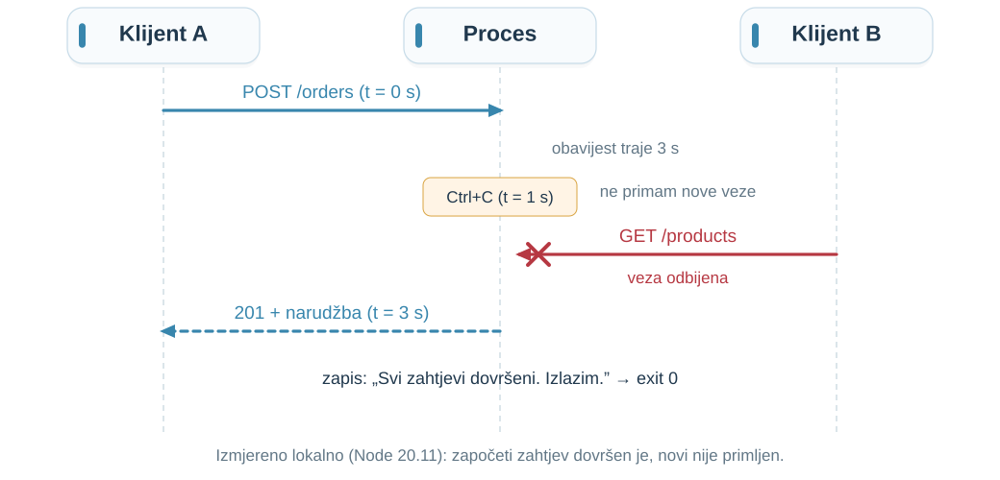
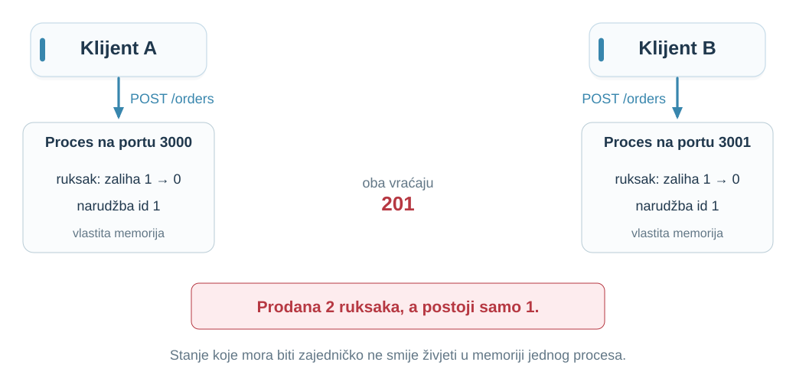
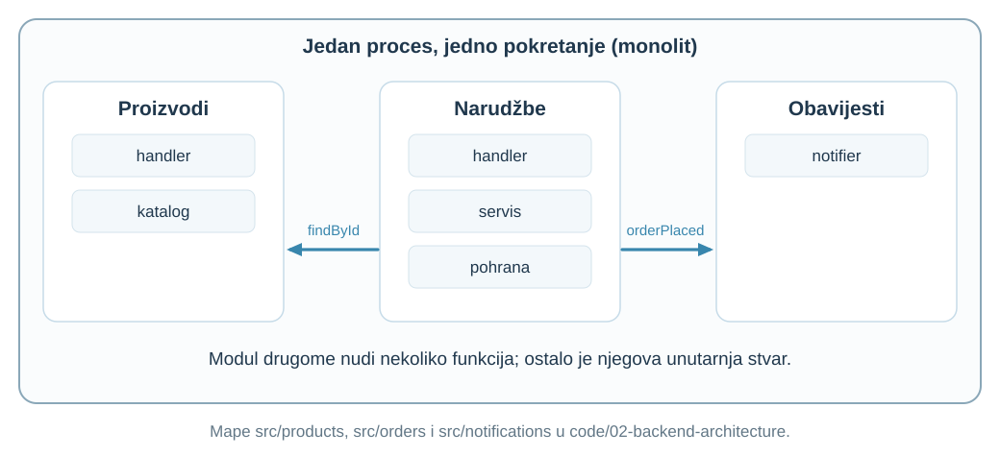

## Evidencija prisutnosti {#attendance .attendance-slide}

::: {.attendance-content}
[{width=455 height=455 fig-alt="QR kod za evidenciju prisutnosti na kolegiju Web aplikacije."}](https://bit.ly/wa-tu-sam)

[bit.ly/wa-tu-sam](https://bit.ly/wa-tu-sam)
:::

::: {.notes}
Vrijeme: 0.5–1 min (0.5 min).
Ostavite pola minute za evidenciju putem QR koda ili poveznice.
:::

## Prošli put: kako biste rasporedili POST /orders? {#s01 .opening-question}

**Prošli put:** poslove narudžbe rasporedili smo između preglednika, backenda i baze. Većina je završila u **backendu**.

**Danas:** kamo ih smjestiti *unutar* backenda, i zašto baš tamo?

U jednoj rečenici: kako ste vi podijelili posao?

::: {.notes}
Skripta: [Prošli put: kako biste rasporedili POST /orders?](chapter.hr.qmd#s01).
Vrijeme: 1–4 min (3 min).

Zamolite dva ili tri para za prijedlog i zapišite ih na ploču; vraćate im se kod vježbe „Gdje pripada pravilo?” i u sažetku.

Očekivano obrazloženje: Nema jednog točnog odgovora; i „sve u jednoj funkciji” je legitimno polazište. Ponovljeni klik i istodobne zahtjeve samo prepoznajte (5. i 9. predavanje).
:::

## Ishodi i predznanje {#s02 .outcomes-slide}

Nakon predavanja moći ćete:

1. **objasniti** zašto zajedničko stanje ne smije biti u memoriji procesa [Razumijevanje]{.bloom .b2}
2. **konfigurirati** backend iz okruženja i uredno ga ugasiti [Primjena]{.bloom .b3}
3. **testirati** pravila servisa s lažnim ovisnostima, bez HTTP-a [Primjena]{.bloom .b3}
4. **razložiti** `POST /orders` na usmjeravanje, HTTP sloj, pravila, podatke i vanjske usluge [Analiza]{.bloom .b4}
5. **obrazložiti** u koji dio koda pripada novo pravilo [Vrednovanje]{.bloom .b5}

::: {.prereq}
[Predznanje]{.prereq-label} predavanje 01 (zahtjev, status, handler, proces, port); `async`/`await`, `import`/`export`.
:::

::: {.notes}
Skripta: [Ishodi i predznanje](chapter.hr.qmd#s02).
Vrijeme: 4–6 min (2 min).

Cilj je obrazložena odluka, ne točan broj slojeva. Ista podjela postoji u Fastifyju, Spring Bootu, ASP.NET Coreu ili Djangu pod drugim imenima.
:::

## Novi zahtjev: POST /orders {#s03}

```http
POST /orders HTTP/1.1
Host: 127.0.0.1:3000
Content-Type: application/json

{"email": "ana@primjer.hr", "items": [{"productId": 7, "quantity": 2}]}
```

```http
HTTP/1.1 201 Created
Content-Type: application/json; charset=utf-8

{"id": 1, "items": [{"productId": 7, "unitPrice": 3.5, …}], "total": 7, …}
```

Novo: **tijelo zahtjeva** i **promjena stanja**. Cijenu klijent ne šalje.

::: {.notes}
Skripta: [Novi zahtjev: POST /orders](chapter.hr.qmd#s03).
Vrijeme: 6–9 min (3 min).

Pitanje: Što je novo u odnosu na GET /products?

Očekivano obrazloženje: tijelo zahtjeva, promjena stanja (zaliha, nova narudžba), status 201. Cijenu ne šalje klijent: Webshop iz 1. predavanja. Odgovor je izvadak stvarnog odgovora nastavnog backenda (izostavljeni email, name, createdAt). Location uvodimo s GET /orders/{id} u 3. predavanju.

Izvori: [RFC 9110, 9.3.3 POST](https://www.rfc-editor.org/rfc/rfc9110.html#name-post); [RFC 9110, 15.3.2 201 Created](https://www.rfc-editor.org/rfc/rfc9110.html#name-201-created).
:::

## Što sve treba napraviti? {#s04}

1. pročitati tijelo i pretvoriti JSON u objekt
2. provjeriti unos: e-pošta, stavke, količine
3. pronaći svaki proizvod i njegovu cijenu
4. provjeriti ima li dovoljno na zalihi
5. umanjiti zalihu i spremiti narudžbu
6. obavijestiti kupca e-poštom
7. odabrati status i poslati odgovor

**Koji poslovi ostaju isti ako narudžbe stižu iz mobilne aplikacije?**

::: {.notes}
Skripta: [Što sve treba napraviti?](chapter.hr.qmd#s04).
Vrijeme: 9–11 min (2 min).

Očekivano obrazloženje: 2–6 ostaju isti; 1 i 7 ovise o HTTP-u. 3 i 5 ovise o tome gdje su podaci, 6 o vanjskoj usluzi. Ta razlika je temelj podjele.
:::

## Naivan handler {#s05 .example-slide .code-slide}

```javascript
// NAMJERNO NAIVNO: sve u jednom handleru (npm run naive)
if (req.method === "POST" && req.url === "/orders") {
  let text = "";
  for await (const chunk of req) text += chunk;
  const body = JSON.parse(text);
  if (!body.email || !Array.isArray(body.items) || body.items.length === 0)
    return send(res, 400, { error: "Neispravna narudžba" });
  let total = 0;
  for (const item of body.items) {
    const product = products.find((p) => p.id === item.productId);
    if (!product || product.stock < item.quantity)
      return send(res, 409, { error: "Nema na zalihi" });
    product.stock -= item.quantity;
    total += product.price * item.quantity;
  }
  const order = { id: orders.length + 1, email: body.email, items: body.items, total };
  orders.push(order);
  console.log(`Šaljem e-poštu na ${body.email}: narudžba ${order.id}`);
  return send(res, 201, order);
}
```

::: {.notes}
Skripta: [Naivan handler](chapter.hr.qmd#s05).
Vrijeme: 11–15 min (4 min).

Ovako izgleda tipičan prvi pokušaj ili odgovor AI asistenta. Kod je kratak i za ispravnu narudžbu radi; cijenu ispravno uzima iz popisa proizvoda. send = writeHead + end s JSON-om. Dajte minutu za čitanje; ne otkrivajte probleme, sljedeći slajd traži predviđanje. products je niz jer baza dolazi u 4. predavanju.
:::

## Predvidite: četiri zahtjeva {#s06 .exercise-slide}

Naivni poslužitelj tek je pokrenut; bilježnica (id 7) ima **zalihu 5**. Šaljemo redom, svaki put s ispravnom e-poštom:

| **Stavke u tijelu** | **Status?** | **Što se dogodi?** |
|:-----|:--|:-----|
| `[{"productId": 7, "quantity": 2}]` | ? | ? |
| `[{"productId": 7, "quantity": "2"}]` | ? | ? |
| `[{"productId": 7, "quantity": -3}]` | ? | ? |
| tijelo `{"email":` (prekinut JSON) | ? | ? |

**Predvidite prema kodu s prethodnog slajda.**

::: {.notes}
Skripta: [Predvidite: četiri zahtjeva](chapter.hr.qmd#s06).
Vrijeme: 15–18 min (3 min).

Parovi dvije minute. Ne otkrivajte odgovore; slijede na idućem slajdu.

Očekivano obrazloženje: (1) 201, ukupno 7, zaliha 5 → 3. (2) 201: 3 < "2" je false, stock -= "2" pretvara tekst u broj; zaliha 3 → 1, a narudžba sprema tekst "2". (3) 201 s ukupno −10,50 €; zaliha raste 1 → 4. (4) JSON.parse baca neuhvaćenu iznimku i cijeli proces se ruši.
:::

## Provjerimo {#s07 .demonstration-slide}

| **Stavke** | **Status** | **Posljedica** |
|:-----|:--|:------|
| `quantity: 2` | `201` | ukupno 7 €, zaliha 5 → 3 |
| `quantity: "2"` | `201` | tekst prolazi kao broj, zaliha 3 → 1 |
| `quantity: -3` | `201` | ukupno **−10,50 €**, zaliha **raste** 1 → 4 |
| prekinut JSON | — | **proces se ruši**: nitko ne dobiva odgovor |

I peti: odbijena narudžba „2 olovke + 5 ruksaka” ipak **troši 2 olovke**.

**Svaka zakrpa je još jedan `if` u istoj funkciji.**

::: {.notes}
Skripta: [Provjerimo](chapter.hr.qmd#s07).
Vrijeme: 18–21 min (3 min).

Demonstracija (provjereno lokalno, Node 20.11): u code/02-backend-architecture pokrenite npm run naive, zatim curl -X POST http://127.0.0.1:3000/orders -H 'Content-Type: application/json' -d '{"email":"a@b.hr","items":[{"productId":7,"quantity":2}]}' i varijante s "2", -3 i '{"email":'. Nakon zadnjeg pokažite SyntaxError u terminalu i da proces više ne odgovara.

Pitanje: Koliko je korisnika pogođeno jednim neispravnim zahtjevom?

Očekivano obrazloženje: svi. Arhitektura sama ne popravlja greške; daje svakom pravilu jedno mjesto i omogućuje provjeru bez pokretanja poslužitelja.
:::

## Jedan handler, sedam poslova {#s08 .process-slide}

{height=540 fig-alt="Sedam redaka naivnog handlera, posao svakog retka i razlog promjene: čitanje tijela, provjera ulaza, pristup podacima, poslovno pravilo, promjena podataka, vanjska usluga i HTTP odgovor."}

::: {.notes}
Skripta: [Jedan handler, sedam poslova](chapter.hr.qmd#s08).
Vrijeme: 21–24 min (3 min).

Pitanje: Koji redak mijenja programer koji uvodi PostgreSQL, a koji onaj koji uvodi popust?

Očekivano obrazloženje: različite retke iste funkcije. Svaka promjena traži čitanje i ponovno testiranje cijele funkcije; dvije osobe mijenjaju isti kod.
:::

## Razdvajanje odgovornosti {#s09}

| **Dio** | **Na koje pitanje odgovara** |
|:---|:-----|
| Usmjeravanje | koji kod obrađuje ovu metodu i putanju? |
| HTTP sloj (handler) | kako čitam zahtjev i koji status vraćam? |
| Servis | koja pravila vrijede za narudžbu? |
| Podaci i vanjske usluge | gdje su podaci, kako šaljem e-poštu? |

::: {.definition number="2.1"}
**Razdvajanje odgovornosti:** kod koji se mijenja iz različitih razloga držimo u zasebnim dijelovima, a oni surađuju preko malog broja jasno imenovanih funkcija.
:::

::: {.notes}
Skripta: [Razdvajanje odgovornosti](chapter.hr.qmd#s09).
Vrijeme: 24–27 min (3 min).

Pojam separation of concerns: Dijkstra, 1974. Imena (controller, service, repository) variraju po frameworku; važna su pitanja. Usporedite s prijedlozima s početka sata. Podjela ima cijenu: svaka nova datoteka je još jedno ime i poziv.

Izvori: [Dijkstra, EWD447](https://www.cs.utexas.edu/~EWD/transcriptions/EWD04xx/EWD447.html); [Fowler, PresentationDomainDataLayering](https://martinfowler.com/bliki/PresentationDomainDataLayering.html).
:::

## Tko koga poziva {#s09b .process-slide}

{height=490 fig-alt="Usmjeravanje poziva HTTP sloj, HTTP sloj poziva servis, servis poziva katalog, pohranu narudžbi i obavijest."}

**Gornji dio zna za HTTP; donji za podatke i vanjske usluge; servis ni za jedno.**

::: {.notes}
Skripta: [Razdvajanje odgovornosti](chapter.hr.qmd#s09).
Vrijeme: 27–28 min (1 min).

Strelica znači „poziva”. Svaki od sljedećih slajdova pokazuje jedan pravokutnik u kodu (code/02-backend-architecture/src).
:::

## Usmjeravanje: metoda i putanja određuju handler {#s10 .code-slide}

```javascript
// src/app.mjs (skraćeno)
const routes = {
  "GET /": serveIndex,
  "GET /products": productHandlers.list,
  "POST /orders": orderHandlers.create,
};
const handler = routes[`${req.method} ${url.pathname}`];
if (handler) return await handler(req, res, url);
// putanja postoji s drugom metodom → 405, inače → 404
// neuhvaćena greška handlera → zapis u terminal i 500
```

**Neispravan JSON sada daje `400`; proces ostaje živ.**

::: {.notes}
Skripta: [Usmjeravanje: metoda i putanja određuju handler](chapter.hr.qmd#s10).
Vrijeme: 28–30 min (2 min).

Usmjeravanje ne sadrži pravila trgovine. Pokažite na pokrenutom backendu (npm start): GET /orders → 405, GET /nesto → 404, POST s '{"email":' → 400 „Tijelo nije valjan JSON”.

Pitanje: Zašto je razlika 404/405 korisna klijentu?

Očekivano obrazloženje: 405 kaže da putanja postoji, ali ne s tom metodom.
:::

## Handler: HTTP ulaz i izlaz {#s11 .code-slide}

```javascript
// src/orders/order-handlers.mjs
async create(req, res) {
  const body = await readJson(req);          // 415 ili 400 ako tijelo nije JSON
  try {
    const order = await orderService.placeOrder(body);
    return sendJson(res, 201, order);
  } catch (error) {
    if (error instanceof ValidationError) return sendJson(res, 400, { error: error.message });
    if (error instanceof OutOfStockError) return sendJson(res, 409, { error: error.message });
    throw error;                             // neočekivano → 500 u app.mjs
  }
}
```

**Handler zna HTTP, a ne zna kako se računa iznos ni gdje su proizvodi.**

::: {.notes}
Skripta: [Handler: HTTP ulaz i izlaz](chapter.hr.qmd#s11).
Vrijeme: 30–33 min (3 min).

U nekim frameworcima zove se controller.

Pitanje: Što se mijenja ako nedovoljna zaliha treba vraćati 422 umjesto 409?

Očekivano obrazloženje: jedan redak u handleru; servis ostaje isti.
:::

## Servis: poslovna pravila bez HTTP-a {#s12 .code-slide}

```javascript
// src/orders/order-service.mjs (skraćeno)
async placeOrder(input) {
  const { email, items } = validate(input);            // ValidationError
  const lines = [];
  for (const { productId, quantity } of items) {
    const product = await catalog.findById(productId);
    if (!product) throw new ValidationError(`Proizvod ${productId} ne postoji`);
    if (product.stock < quantity) throw new OutOfStockError(`Nema dovoljno: ${product.name}`);
    lines.push({ productId, name: product.name, quantity, unitPrice: product.price });
  }
  for (const line of lines) await catalog.decreaseStock(line.productId, line.quantity);
  const order = await orders.save({ email, items: lines, total: sum(lines) });
  await notifyQuietly(order);                          // greška obavijesti ne ruši narudžbu
  return order;
}
```

`validate`: cijeli broj ≥ 1, svaki proizvod jednom. Zaliha se umanjuje tek **nakon** provjere svih stavki.

::: {.notes}
Skripta: [Servis: poslovna pravila bez HTTP-a](chapter.hr.qmd#s12).
Vrijeme: 33–37 min (4 min).

Servis ne poznaje req, res ni statuse. "2" i -3 sada daju ValidationError; odbijena narudžba više ne troši zalihu. Komentar u kodu: između provjere i umanjenja postoji await, pa dva istodobna zahtjeva mogu oba proći provjeru za zadnji ruksak (check-then-act, 5. predavanje). Podjela ne rješava konkurentnost; samo je lakše pronaći pravilo.

Pitanje: Može li se ovaj servis pozvati iz skripte za uvoz narudžbi iz CSV-a?

Očekivano obrazloženje: Da; ne ovisi o req i res.
:::

## Repozitorij: pristup podacima {#s13 .code-slide}

```javascript
// src/products/memory-catalog.mjs (skraćeno)
export function createMemoryCatalog() {
  const products = [{ id: 7, name: "Bilježnica", price: 3.5, stock: 5 }, /* … */];
  return {
    async list() { return products.map(({ id, name, price }) => ({ id, name, price })); },
    async findById(id) { const p = products.find((x) => x.id === id); return p ? { ...p } : null; },
    async decreaseStock(id, quantity) { products.find((x) => x.id === id).stock -= quantity; },
  };
}
```

**Repozitorij** skriva gdje su podaci. Danas niz, u 4. predavanju PostgreSQL, iste funkcije.

`async` zbog buduće baze; `{ ...p }` je kopija, pa zalihu mijenja samo `decreaseStock`.

::: {.notes}
Skripta: [Repozitorij: pristup podacima](chapter.hr.qmd#s13).
Vrijeme: 37–40 min (3 min).

list ne izlaže zalihu: odluka o javnim poljima iz 1. predavanja.

Pitanje: Što ako findById vraća izvorni objekt umjesto kopije?

Očekivano obrazloženje: kod izvan kataloga mogao bi mijenjati zalihu mimo decreaseStock; teško je pronaći tko je promijenio podatak.

Izvori: [Fowler, Repository](https://martinfowler.com/eaaCatalog/repository.html).
:::

## Obavijest: vanjska usluga iza funkcije {#s14}

Servis zna samo `notifier.orderPlaced(order)`. Nastavni backend e-poštu ispisuje u terminal.

| **`NOTIFIER`** | **Ponašanje** | **Odgovor klijentu** |
|:--|:----|:----|
| `console` | redak u terminalu | `201` |
| `slow` | čeka 3 s | `201` nakon 3 s |
| `fail` | usluga ne radi | `201`; greška u zapisu |

**Narudžba je spremljena: `500` bi tvrdio da nije.**

::: {.notes}
Skripta: [Obavijest: vanjska usluga iza funkcije](chapter.hr.qmd#s14).
Vrijeme: 40–42 min (2 min).

Provjereno: NOTIFIER=fail npm start i jedna narudžba → 201, terminal „Obavijest za narudžbu 1 nije poslana”. Cijena odluke: kupac možda ne dobije e-poštu; sa slow svaki odgovor kasni 3 s. Oba vode u 8. predavanje (pozadinski posao).

Pitanje: Je li ispravno vratiti 201?

Očekivano obrazloženje: prihvatite raspravu; odgovor ne smije tvrditi nešto netočno o spremljenoj narudžbi.
:::

## POST /orders kroz dijelove {#s15 .process-slide}

{height=560 fig-alt="Slijed: handler poziva placeOrder, servis pita katalog findById, umanjuje zalihu, sprema narudžbu, poziva orderPlaced i vraća narudžbu handleru, koji šalje 201."}

::: {.notes}
Skripta: [POST /orders kroz dijelove](chapter.hr.qmd#s15).
Vrijeme: 42–45 min (3 min).

Strelice su pozivi funkcija u istom procesu, ne mrežne poruke. Za greške put je kraći: ValidationError ili OutOfStockError prekidaju servis prije ijedne promjene.

Pitanje: U kojem koraku NOTIFIER=slow produljuje odgovor?

Očekivano obrazloženje: kod orderPlaced; servis čeka obavijest prije povratka.
:::

## Vježba: gdje pripada pravilo? {#s16 .exercise-slide}

| **Pravilo** | **Gdje?** |
|:------|:--|
| Tijelo mora imati `Content-Type: application/json`. | ? |
| Količina je cijeli broj veći od nule. | ? |
| Cijena stavke uzima se iz kataloga. | ? |
| Nedovoljna zaliha vraća status `409`. | ? |
| Proizvod se traži po identifikatoru. | ? |
| Novo: najviše 5 komada istog proizvoda. | ? |
| Poslužitelj sluša na portu 3000. | ? |

**Usmjeravanje, HTTP sloj, servis, katalog ili konfiguracija? Obrazložite.**

::: {.notes}
Skripta: [Vježba: gdje pripada pravilo?](chapter.hr.qmd#s16).
Vrijeme: 45–49 min (4 min).

Parovi dvije minute, zatim prolaz.

Očekivano obrazloženje: Content-Type → HTTP sloj (readJson). Količina → servis; obranjivo i dodatno u HTTP sloju kao provjera oblika (Fastify sheme, 3. predavanje), ali pravilo mora vrijediti i bez HTTP-a. Cijena → servis. 409 → HTTP sloj (pravilo „nema dovoljno” je u servisu). Traženje po id-u → katalog. Najviše 5 komada → servis. Port → konfiguracija. Usporedite s prijedlozima s početka sata.
:::

## Greške prelaze granicu {#s17}

| **Izvor** | **Greška** | **HTTP odgovor** |
|:---|:---|:---|
| `readJson` | tijelo nije JSON | `415` ili `400` |
| servis | `ValidationError` | `400` |
| servis | `OutOfStockError` | `409` |
| bilo što neočekivano | ostale greške | `500` + zapis (`app.mjs`) |

**Servis opisuje što se dogodilo; HTTP sloj odlučuje kako to reći klijentu.**

Za `500` klijent dobiva općenitu poruku; detalj ide samo u zapis.

::: {.notes}
Skripta: [Greške prelaze granicu](chapter.hr.qmd#s17).
Vrijeme: 49–52 min (3 min).

Svi statusi provjereni curl zahtjevima na pokrenutom backendu. Oblik grešaka dogovaramo u 3. predavanju, sigurnosni aspekt otkrivanja detalja u 7.

Pitanje: Zašto servis ne baca odmah { status: 409 }?

Očekivano obrazloženje: tada bi ovisio o HTTP-u; skripta za uvoz ne bi znala što sa statusom.
:::

## Smjer ovisnosti {#s18 .process-slide}

{height=340 fig-alt="HTTP sloj poziva servis, servis poziva ovisnosti. server.mjs stvara sve tri i predaje ih."}

::: {.definition number="2.2"}
**Smjer ovisnosti:** poslovna pravila ne ovise o detaljima poput HTTP-a, baze ili e-pošte. Detalji ovise o pravilima ili im se predaju izvana.
:::

::: {.notes}
Skripta: [Smjer ovisnosti](chapter.hr.qmd#s18).
Vrijeme: 52–55 min (3 min).

Ovisiti = uvoziti ili pozivati; promjena u drugom modulu može nas pokvariti. U literaturi: dependency inversion, ports and adapters, heksagonalna arhitektura; danas su važne strelice, ne imena.

Pitanje: Gdje je u order-service.mjs riječ import?

Očekivano obrazloženje: nigdje. Servis ne uvozi nijedan modul; greške definira sam, ovisnosti dobiva kao parametre. Pokažite datoteku.

Izvori: [Fowler, Dependency Injection (2004)](https://martinfowler.com/articles/injection.html).
:::

## Ubrizgavanje ovisnosti {#s19 .code-slide}

```javascript
// Bez ubrizgavanja: servis sam bira implementacije
import { products } from "./products-array.mjs";
import { sendEmail } from "./smtp.mjs";

// S ubrizgavanjem: servis dobiva ovisnosti (order-service.mjs)
export function createOrderService({ catalog, orders, notifier }) { /* … */ }

// server.mjs: jedino mjesto koje bira konkretne implementacije
const catalog = createMemoryCatalog();
const orderService = createOrderService({
  catalog,
  orders: createMemoryOrders(),
  notifier: createNotifier({ mode: config.notifier }),
});
```

**Ubrizgavanje ovisnosti:** dio koda ne stvara ono o čemu ovisi, nego to dobiva izvana. Za to ne treba biblioteka.

::: {.notes}
Skripta: [Ubrizgavanje ovisnosti](chapter.hr.qmd#s19).
Vrijeme: 55–58 min (3 min).

Mjesto koje sastavlja aplikaciju: composition root (server.mjs). Isti katalog dobivaju servis narudžbi i handler proizvoda. Spring i ASP.NET Core imaju spremnike koji to rade automatski.

Pitanje: Što bi GET /products pokazivao nakon narudžbe da servis i handler proizvoda stvore svaki svoj katalog?

Očekivano obrazloženje: dvije zasebne zalihe; isti problem kao dva procesa, samo unutar jednog.
:::

## Dokaz: test pravila bez HTTP-a {#s20 .demonstration-slide .code-slide}

```javascript
// test/order-service.test.mjs (skraćeno)
test("cijena dolazi iz kataloga, ne iz zahtjeva", async () => {
  const service = createOrderService({
    catalog: createMemoryCatalog(),
    orders: createMemoryOrders(),
    notifier: { orderPlaced: async () => {} },   // lažna e-pošta
  });
  const order = await service.placeOrder({
    email: "a@b.hr", items: [{ productId: 7, quantity: 2, price: 0.01 }],
  });
  assert.equal(order.total, 7);
});
```

`npm test`{.cmd} → pet testova, `# pass 5`, oko 60 ms, bez poslužitelja, mreže i e-pošte.

::: {.notes}
Skripta: [Dokaz: test pravila bez HTTP-a](chapter.hr.qmd#s20).
Vrijeme: 58–61 min (3 min).

Pokrenite npm test uživo. Zatim namjerno pokvarite pravilo (npr. unitPrice: item.price ?? product.price) i pokažite koji test pada. Upozorite: testovi ne otkrivaju utrku dvaju istodobnih zahtjeva; test koji prolazi nije dokaz ispravnosti (11. predavanje).

Izvori: [Node.js: node:test](https://nodejs.org/api/test.html).
:::

## Zamjena implementacije {#s21 .process-slide}

{height=500 fig-alt="Servis koristi katalog s funkcijama findById i decreaseStock; ostvaruju ih memorijski katalog danas, PostgreSQL u 4. predavanju i lažni katalog u testu."}

::: {.notes}
Skripta: [Zamjena implementacije](chapter.hr.qmd#s21).
Vrijeme: 61–63 min (2 min).

JavaScript ne provjerava ima li predani objekt sve funkcije; otkrivamo pri pozivu ili testom. TypeScript, Java i C# to provjeravaju ranije pomoću sučelja (interface). Najavite: u 4. predavanju createPostgresCatalog() i jedan promijenjeni redak u server.mjs.
:::

## Ne treba sloj za svaku funkciju {#s22 .code-slide}

```javascript
// Slojevi koji ništa ne dodaju
class ProductService    { list() { return this.repository.list(); } }
class ProductController { list() { return this.productService.list(); } }
```

`GET /products` nema pravila: naš handler **izravno poziva katalog**, bez servisa.

Servis narudžbi postoji jer ima pravila koja želimo testirati i odvojiti od HTTP-a.

**Za svaki novi dio: koji razlog za promjenu izdvaja?**

::: {.notes}
Skripta: [Ne treba sloj za svaku funkciju](chapter.hr.qmd#s22).
Vrijeme: 63–66 min (3 min).

Česta pojava u generiranom kodu: kontroler, servis i repozitorij za svaki endpoint, iako samo prosljeđuju.

Pitanje: Kada biste dodali ProductService?

Očekivano obrazloženje: kad se pojavi pravilo koje ne pripada ni HTTP-u ni pohrani, npr. skriveni proizvodi za neprijavljene korisnike.
:::

## Konfiguracija dolazi iz okruženja {#s23}

| **Varijabla** | **Lokalno** | **Produkcija (primjer)** |
|:---|:---|:---|
| `PORT` | `3000` | dodjeljuje platforma |
| `HOST` | `127.0.0.1` | `0.0.0.0` (sve adrese) |
| `NOTIFIER` | `console` | pravi pružatelj |
| `EMAIL_API_KEY` | prazno | tajna iz upravitelja tajni |

**Kod je isti; mijenja se konfiguracija.** Čita je `src/config.mjs`, jednom, pri pokretanju.

`PORT=3001 npm start`{.cmd} ili datoteka `.env` uz `npm run start:env`{.cmd} (`node --env-file`).

::: {.notes}
Skripta: [Konfiguracija dolazi iz okruženja](chapter.hr.qmd#s23).
Vrijeme: 66–69 min (3 min).

Varijabla okruženja: imenovana vrijednost koju operacijski sustav predaje procesu pri pokretanju. Ostatak koda dobiva gotov, zamrznut objekt (Object.freeze) i ne čita process.env sam. --env-file postoji od Node.js 20.6. Na Windowsu (PowerShell): $env:PORT=3001; npm start (nije isprobano).

Pitanje: Zašto ne čitati process.env.PORT izravno u handleru?

Očekivano obrazloženje: rasuta konfiguracija ne može se provjeriti na jednom mjestu, a test bi morao mijenjati okruženje procesa.

Izvori: [Twelve-Factor App: Config](https://12factor.net/config); [Node.js: --env-file](https://nodejs.org/api/cli.html#--env-fileconfig).
:::

## Tajne {#s24}

**Tajna** je konfiguracija kojom netko može djelovati u ime aplikacije: lozinka baze, API ključ.

- **ne u kodu:** `const EMAIL_API_KEY = "re_8f2a…"` vidi svatko tko vidi kod
- **ne u gitu:** `.env` je u `.gitignore`; u repozitoriju samo `.env.example`
- **ne u zapisima:** pri pokretanju piše samo `emailApiKey: '(postavljen)'`
- **ako procuri, zamijeni je:** brisanje commita ne briše povijest ni tuđe kopije

::: {.notes}
Skripta: [Tajne](chapter.hr.qmd#s24).
Vrijeme: 69–71 min (2 min).

Provjereno: s postavljenim EMAIL_API_KEY zapis pri pokretanju prikazuje samo „(postavljen)”.

Pitanje: Student je predao .env s ključem na GitHub i odmah ga obrisao novim commitom. Je li problem riješen?

Očekivano obrazloženje: Ne. Ključ je u povijesti i mogao je biti kopiran; treba ga poništiti kod pružatelja i izdati novi.

Izvori: [OWASP: Secrets Management Cheat Sheet](https://cheatsheetseries.owasp.org/cheatsheets/Secrets_Management_Cheat_Sheet.html).
:::

## Neispravna konfiguracija zaustavlja pokretanje {#s25}

```{.terminal code-line-numbers="false"}
$ PORT=abc npm start
Neispravna konfiguracija: PORT mora biti cijeli broj 1–65535, a dobiven je "abc"
$ echo $?
1
$ npm start          # dok drugi proces već sluša na 3000
Pokretanje nije uspjelo: EADDRINUSE (127.0.0.1:3000)
```

**Bolje odbiti pokretanje odmah nego vratiti `500` prvom kupcu u tri ujutro.**

::: {.notes}
Skripta: [Neispravna konfiguracija zaustavlja pokretanje](chapter.hr.qmd#s25).
Vrijeme: 71–73 min (2 min).

Načelo fail fast. Izlazni kod različit od nule govori alatu koji pokreće proces da pokretanje nije uspjelo. Oba ispisa provjerena lokalno. Pokažite i NOTIFIER=email npm start.

Pitanje: Što bi se dogodilo s NOTIFIER=email da nema provjere?

Očekivano obrazloženje: ovisi o kodu; vjerojatno bi e-pošta tiho radila u zadanom načinu, a greška bi se otkrila tek kad kupci ne dobiju poruke.
:::

## Životni ciklus procesa {#s26 .process-slide}

{height=540 fig-alt="Pokretanje: konfiguracija, sastavljanje ovisnosti, listen, rad. Gašenje na SIGINT ili SIGTERM: server.close, dovršavanje započetih zahtjeva, exit 0. Izlazi s greškom: neispravna konfiguracija, zauzet port, gašenje dulje od 10 s."}

::: {.notes}
Skripta: [Životni ciklus procesa](chapter.hr.qmd#s26).
Vrijeme: 73–76 min (3 min).

Povežite s 1. predavanjem („Program, proces i računalo”). SIGINT šalje Ctrl+C; platforma pri novoj isporuci obično šalje SIGTERM.

Pitanje: Zašto listen dolazi zadnji?

Očekivano obrazloženje: da prvi zahtjev ne stigne prije nego što su servis i katalog spremni.

Izvori: [Node.js: Signal events](https://nodejs.org/api/process.html#signal-events); [Twelve-Factor App: Disposability](https://12factor.net/disposability).
:::

## Uredno gašenje {#s27 .demonstration-slide .process-slide}

{height=470 fig-alt="Izmjereno: klijent A šalje narudžbu u t=0; Ctrl+C u t=1 s; novi zahtjev klijenta B je odbijen; A dobiva 201 u t=3 s; proces izlazi s kodom 0."}

`server.close()`: **ne primaj nove veze, dovrši započete, zatim izađi.** Gornja granica 10 s.

::: {.notes}
Skripta: [Uredno gašenje](chapter.hr.qmd#s27).
Vrijeme: 76–80 min (4 min).

Demonstracija (izmjereno lokalno, Node 20.11): NOTIFIER=slow npm start; u drugom terminalu narudžba curlom; odmah Ctrl+C u prvom. curl dobiva 201, tek tada proces izlazi. Kod je u server.mjs, funkcija shutdown. Neaktivna keep-alive veza ne odgađa gašenje (provjereno: izlaz nakon 0,2 s).

Pitanje: Što bi se dogodilo samo s process.exit(0)?

Očekivano obrazloženje: veza bi se prekinula bez odgovora; klijent ne zna je li narudžba spremljena (izgubljeni odgovor iz 1. predavanja). Uredno gašenje ne pomaže kod nestanka struje ili SIGKILL: memorija se gubi → trajna pohrana (4. predavanje).

Izvori: [Node.js: server.close()](https://nodejs.org/api/http.html#serverclosecallback).
:::

## Dva procesa, jedan ruksak {#s28 .demonstration-slide .process-slide}

{height=530 fig-alt="Dva procesa na portovima 3000 i 3001, svaki sa zalihom ruksaka 1 u vlastitoj memoriji. Oba prihvaćaju narudžbu i vraćaju 201; prodana su 2 ruksaka, postoji 1."}

::: {.notes}
Skripta: [Dva procesa, jedan ruksak](chapter.hr.qmd#s28).
Vrijeme: 80–83 min (3 min).

Demonstracija (provjereno lokalno): npm start i PORT=3001 npm start, zatim narudžba ruksaka (productId 9, quantity 1) na oba porta. Oba vraćaju 201 i id 1.

Pitanje: Koliko je ruksaka prodano? Što bi trebao vidjeti proces B?

Očekivano obrazloženje: dva, a postoji jedan. Proces B bi trebao vidjeti zalihu 0, ali zaliha živi u memoriji procesa A. Nije utrka (5. predavanje), nego stanje na mjestu koje nije zajedničko → baza.
:::

## Aplikacijski poslužitelj bez stanja {#s29}

::: {.definition number="2.3"}
**Aplikacijski poslužitelj bez stanja:** proces ne čuva u svojoj memoriji podatke koji moraju preživjeti njegovo gašenje ili biti vidljivi drugim procesima; takvo stanje drži u zajedničkoj pohrani.
:::

| **Stanje** | **Danas** | **Kamo ide** |
|:---|:---|:---|
| proizvodi, zaliha, narudžbe | memorija procesa | baza (4.) |
| prijava korisnika | — | zajednička pohrana ili token (6.) |
| e-pošta, račun | čeka se u zahtjevu | red poslova i worker (8.) |

::: {.notes}
Skripta: [Aplikacijski poslužitelj bez stanja](chapter.hr.qmd#s29).
Vrijeme: 83–85 min (2 min).

Nije isto što „HTTP je stateless” (protokol); ovdje je riječ o tome gdje proces drži podatke. Nastavni backend namjerno još nije bez stanja.

Pitanje: Smije li proces imati varijablu u memoriji?

Očekivano obrazloženje: da, ako njezin gubitak ili razlika među procesima ne mijenja ispravnost (npr. brojač zahtjeva za zapis).

Izvori: [Twelve-Factor App: Processes](https://12factor.net/processes).
:::

## Monolit nije pogreška {#s30}

**Monolit:** aplikacija koja se gradi, pokreće i isporučuje kao jedna cjelina.

| **Prednost** | **Cijena** |
|:-----|:-----|
| jedno pokretanje, jedan zapis | sve se isporučuje zajedno |
| poziv funkcije, ne mrežna poruka | bez discipline granice nestaju |
| jedna transakcija za više promjena | jedan proces nosi sav teret |

Mikroservisi pretvaraju pozive funkcija u mrežne poruke, sa svim kvarovima iz 1. predavanja.

::: {.notes}
Skripta: [Monolit nije pogreška](chapter.hr.qmd#s30).
Vrijeme: 85–87 min (2 min).

Riječ opisuje način isporuke, ne kvalitetu koda. Kada i zašto razdvojiti usluge: 12. predavanje.

Pitanje: Koji kvarovi iz 1. predavanja nastaju kad catalog.findById postane HTTP zahtjev drugoj usluzi?

Očekivano obrazloženje: kašnjenje, izgubljen odgovor, nedostupnost.

Izvori: [Fowler, MonolithFirst](https://martinfowler.com/bliki/MonolithFirst.html).
:::

## Modularni monolit {#s31 .process-slide}

{height=480 fig-alt="Jedan proces s modulima Proizvodi, Narudžbe i Obavijesti; Narudžbe koriste findById od Proizvoda i orderPlaced od Obavijesti."}

**Dijelimo po području posla; modul drugima nudi samo nekoliko funkcija.**

::: {.notes}
Skripta: [Modularni monolit](chapter.hr.qmd#s31).
Vrijeme: 87–90 min (3 min).

Otvorite stablo mapa: src/products, src/orders, src/notifications, src/app.mjs, server.mjs. Narudžbe od proizvoda koriste findById i decreaseStock. Podjela po tehničkim slojevima (controllers/, services/) također je česta; po području lakše raste.

Pitanje: Kamo bi išao modul za račune (8. predavanje)?

Očekivano obrazloženje: src/invoices/, s jednom funkcijom koju poziva servis narudžbi ili worker.
:::

## Isti servis u Fastifyju {#s32 .code-slide}

```javascript
// Skica: isti orderService, drugi HTTP sloj (nije dio nastavnog koda)
import Fastify from "fastify";
const app = Fastify({ logger: true });
app.get("/products", async () => catalog.list());
app.post("/orders", async (request, reply) => {
  try {
    return reply.code(201).send(await orderService.placeOrder(request.body));
  } catch (error) {
    if (error instanceof ValidationError) return reply.code(400).send({ error: error.message });
    if (error instanceof OutOfStockError) return reply.code(409).send({ error: error.message });
    throw error;
  }
});
await app.listen({ port: config.port, host: config.host });
process.once("SIGINT", () => app.close());
```

**Servis, katalog i obavijest ostaju isti.** Mijenja se samo HTTP sloj i pokretanje.

::: {.notes}
Skripta: [Isti servis u Fastifyju](chapter.hr.qmd#s32).
Vrijeme: 90–93 min (3 min).

request.body je već parsiran JSON; neuhvaćenu grešku Fastify pretvara u 500; app.close() čeka započete zahtjeve. NIJE POKRENUTO u ovoj verziji (potreban paket fastify) — provjerite prije nastave.

Pitanje: Koji redak order-service.mjs treba promijeniti za Fastify?

Očekivano obrazloženje: nijedan.

Izvori: [Fastify: Routes](https://fastify.dev/docs/latest/Reference/Routes/); [Fastify: Server](https://fastify.dev/docs/latest/Reference/Server/); [Fastify: Reply](https://fastify.dev/docs/latest/Reference/Reply/).
:::

## Što framework preuzima, a što ostaje naše {#s33}

| **Posao** | **Ručno (`node:http`)** | **Fastify** |
|:---|:---|:---|
| usmjeravanje | objekt `routes`, 404/405 | `app.get`, `app.post` |
| čitanje JSON tijela | `readJson` | ugrađeno |
| provjera oblika tijela | ručno u servisu | JSON shema (3. predavanje) |
| zapisi zahtjeva | `res.on("finish", …)` | `logger: true` |
| uredno gašenje | `server.close()` | `app.close()` |
| **pravila, podaci, obavijest** | **naš kod** | **naš kod** |

::: {.notes}
Skripta: [Što framework preuzima, a što ostaje naše](chapter.hr.qmd#s33).
Vrijeme: 93–95 min (2 min).

Framework uklanja ponavljajući HTTP kod; ne odlučuje gdje su pravila ni kako se zaliha ne smije prodati dvaput. Iste dijelove student prepoznaje u Spring Bootu, ASP.NET Coreu ili FastAPI-ju.
:::

## AI kod na pregledu {#s34 .exercise-slide .code-slide}

```javascript
const EMAIL_API_KEY = "re_8f2a91c4d7…";

export async function placeOrder(req, res) {
  const { email, items, total } = req.body;
  const order = await db.orders.insert({ email, items, total });
  console.log("Narudžba", order, "ključ", EMAIL_API_KEY);
  await sendEmail(EMAIL_API_KEY, email, order);
  res.status(201).json(order);
}
```

Upit: „napiši servis za narudžbe s e-poštom”. Za ispravan zahtjev radi.

**Pronađite barem četiri problema. Koja je posljedica i gdje bi taj dio trebao biti?**

::: {.notes}
Skripta: [AI kod na pregledu](chapter.hr.qmd#s34).
Vrijeme: 95–99 min (4 min).

Parovi tri minute, zatim prolaz.

Očekivano obrazloženje: (1) tajna u kodu → konfiguracija iz okruženja; (2) tajna u zapisu → nikad ne ispisivati; (3) total od klijenta → servis računa iz kataloga; (4) „servis” prima req/res → nije testabilan bez HTTP-a, HTTP pripada handleru; (5) nema provjere unosa ni zalihe; (6) ako sendEmail baci grešku nakon spremanja, klijent dobiva 500 iako je narudžba spremljena; (7) db i sendEmail uvezeni su globalno, zamjena u testu nije moguća.
:::

## Sažetak {#s35}

- Jedan handler miješa **sedam poslova** sa sedam razloga za promjenu.
- Usmjeravanje → HTTP sloj → servis → repozitorij i vanjske usluge.
- Pravila ne ovise o detaljima; ovisnosti im predaje `server.mjs`.
- Sloj dodajemo kad izdvaja stvaran razlog za promjenu.
- Konfiguracija iz okruženja, provjerena pri pokretanju; tajne izvan koda.
- Uredno gašenje; zajedničko stanje **nije** u memoriji procesa.
- Monolit je legitiman; modularni čuva granice.

::: {.notes}
Skripta: [Sažetak](chapter.hr.qmd#s35).
Vrijeme: 99–101 min (2 min).

Vratite se na prijedloge s početka sata. Pitajte jedan par bi li sada promijenio svoj prijedlog i zašto.
:::

## Osmislite sljedeći korak {#s36 .exercise-slide}

Narudžbe će slati i **mobilna aplikacija** i **partnerski sustav**. Njihovi timovi ne čitaju naš kod.

**Što im moramo obećati?** Ispravan zahtjev, mogući odgovori i statusi, oblik greške, što smiju ponoviti.

Dodatni uvjet: usluga e-pošte počinje odgovarati za **30 sekundi**. Što se događa s odgovorom na `POST /orders`?

::: {.notes}
Skripta: [Osmislite sljedeći korak](chapter.hr.qmd#s36).
Vrijeme: 101–104 min (3 min).

Otvoreni zadatak bez jednog točnog odgovora. Prihvatite dokumentirani primjer zahtjeva, popis statusa ili zajednički oblik greške. Za ponavljanje je „ne znamo, ovisi” dobar odgovor (9. predavanje). Kašnjenje e-pošte vodi prema odvajanju obavijesti od odgovora (8. predavanje). Najavite: sljedeći put pišemo ugovor API-ja (3. predavanje).
:::

## Literatura {.references-slide}

- [RFC 9110: HTTP Semantics](https://www.rfc-editor.org/rfc/rfc9110.html)
- [Dijkstra: On the role of scientific thought (EWD447, 1974)](https://www.cs.utexas.edu/~EWD/transcriptions/EWD04xx/EWD447.html)
- [Fowler: Presentation Domain Data Layering](https://martinfowler.com/bliki/PresentationDomainDataLayering.html) · [Repository](https://martinfowler.com/eaaCatalog/repository.html)
- [Fowler: Inversion of Control Containers and the Dependency Injection pattern](https://martinfowler.com/articles/injection.html)
- [Fowler: MonolithFirst](https://martinfowler.com/bliki/MonolithFirst.html)
- [The Twelve-Factor App: Config, Processes, Disposability](https://12factor.net/)
- [OWASP: Secrets Management Cheat Sheet](https://cheatsheetseries.owasp.org/cheatsheets/Secrets_Management_Cheat_Sheet.html)
- [Node.js: HTTP](https://nodejs.org/api/http.html) · [Process](https://nodejs.org/api/process.html) · [Test runner](https://nodejs.org/api/test.html)
- [Fastify dokumentacija](https://fastify.dev/docs/latest/)

::: {.notes}
Vrijeme: 104–105 min (1 min).
:::
